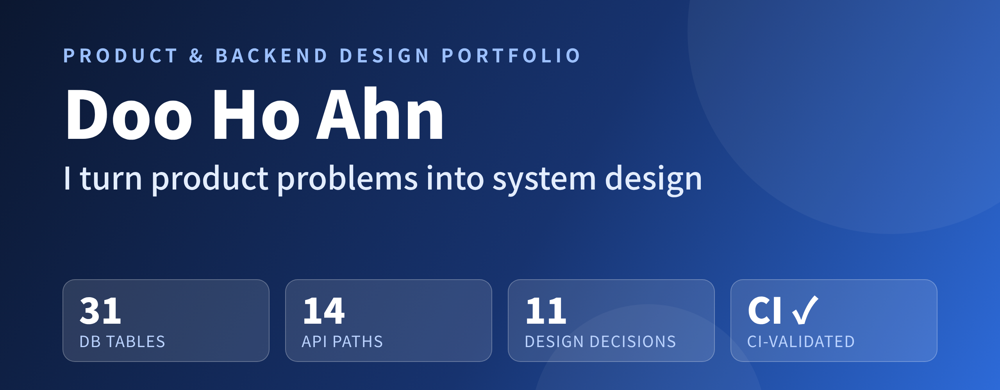
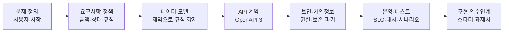
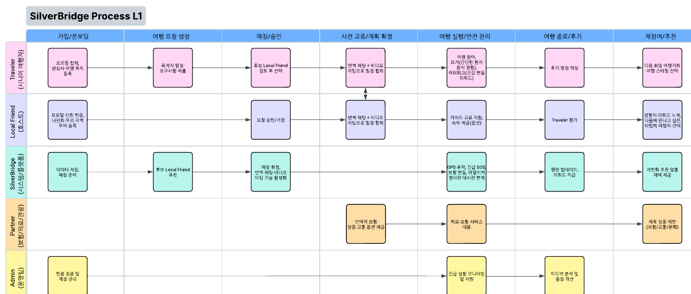
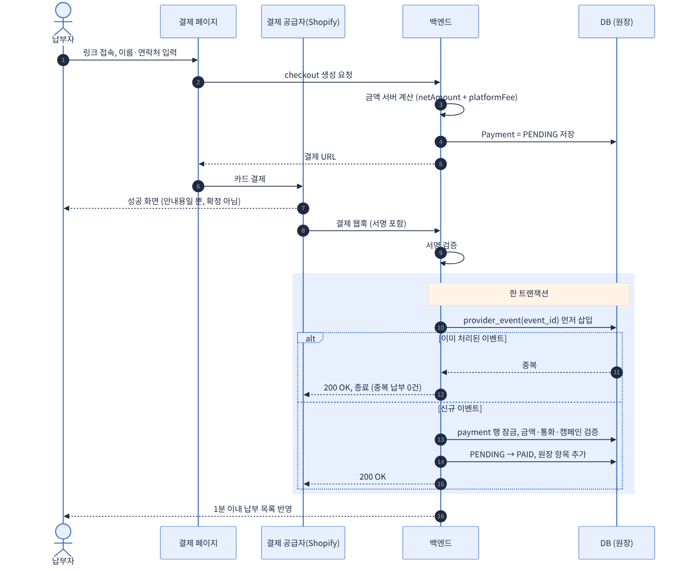

<div align="center">

🌐 [English](README.md) · **한국어**



<br>


[](https://github.com/HoDoo7081/dooho-dev-portfolio/actions/workflows/validate.yml)


**Enterprise SaaS 프로젝트·솔루션 컨설팅 경력** 위에서 직접 기획·설계한 서비스의 산출물 모음<br>
KAIST PMBA (Data Science 부전공) · 📧 [dksengh7081@gmail.com](mailto:dksengh7081@gmail.com)

</div>

> **English summary** — Two end-to-end design packages. (1) **SilverBridge**: an AI-assisted travel companion platform for seniors — PostgreSQL schema (31 tables), OpenAPI 3 contract, security/ops/test strategy and a NestJS starter. (2) **Fee Payment Link**: a card-payment-link MVP for club treasurers — PRD and money/ledger/refund/settlement design built on webhook idempotency. Design-first work; implementation status is stated honestly in each README.

---

## 엔터프라이즈 구축·솔루션 컨설팅 경험

**빠르게 보기:** [직무별 경력·기술 증빙](docs/ROLE-EVIDENCE.md) · [가상 고객 Discovery → PoC → 구축 계획 예시](playbooks/worked-example-travel-marketplace.md) · [5분 영문 고객 데모 발표안](docs/CUSTOMER-DEMO.md). 가상 사례와 발표안은 공개용으로 작성했으며 실제 고객 수행·발표 실적으로 주장하지 않습니다.

고객 요구사항을 기술 설계와 실행 계획으로 전환하고, APAC 고객·글로벌 조직과 함께 도입 및 활용을 지원한 경험입니다.

| 경력 사례 | 담당 영역 | 규모 및 근거 |
|---|---|---|
| [Medidata](enterprise-case-studies/medidata-apac-saas-implementation.md) | SaaS 구축, UAT, go-live, 리스크·리소스 관리, 고객 교육 | 50개 이상 고객 프로그램, 약 25–30건 신규 구현, 최대 11개 동시 프로젝트, 월 PS labor forecast 정확도 약 97% |
| [Clarivate](enterprise-case-studies/clarivate-solution-consulting.md) | Discovery, demo, PoC, 데이터·연계·SSO 요구사항, 범위 정의와 구축 인계 | 고객·영업·제품·기술·구축 조직 조율 및 AI 도입 준비 브리핑 |
| [Johnson & Johnson](enterprise-case-studies/jnj-digital-transformation-enablement.md) | AI 활용 확대, CRM/ERP 도입 지원, UAT, 교육·변경관리 | 아시아 8개 시장 AI 플랫폼, 한국 4개 법인 SAP ECC-to-Ariba 변경관리, 연 30–40개 medical event/advisory board |

[경력 사례 및 공개 범위 안내](enterprise-case-studies/README.md) · [Discovery·워크숍·PoC·구축 인계 템플릿](playbooks/README.md)

경력 사례는 본인 경험에 근거한 요약이며 고객명·내부 문서·독점 구현정보를 포함하지 않습니다. 템플릿은 공개용으로 새로 작성한 예시입니다.

## 한눈에 보기

| 31 | 14 | 11 | 2 |
|:---:|:---:|:---:|:---:|
| PostgreSQL 테이블<br><sub>CI가 31개 자동 검증</sub> | OpenAPI 경로<br><sub>인증·예약·결제·안전 등</sub> | 설계 결정 기록(ADR)<br><sub>배경·결정·결과·대안</sub> | 설계 패키지<br><sub>SilverBridge · Fee Payment Link</sub> |

## 이 저장소의 의도

코드 양을 보여주기보다 **제품 문제를 시스템 설계로 번역하는 과정**을 보여주려는 저장소입니다. "만들기 전에 합의해야 할 것들"을 문서로 못 박는 것이 제 강점입니다.



| 단계 | 어디서 확인할 수 있나 |
|---|---|
| 문제 정의·사용자 분석 | SilverBridge README §1–2, Fee Payment PRD §2–4 |
| 요구사항·정책 | Fee Payment PRD (금액 정책, 상태 모델, 환불·정산 규칙) |
| 데이터 모델링 | SilverBridge `02_SQL/schema.sql` (31개 테이블, 제약조건) |
| API 계약 | SilverBridge `03_API/openapi.yaml` |
| 보안·개인정보 | 권한 매트릭스, 보존·파기·암호화 표 |
| 운영·신뢰성 | SLO, 파티셔닝, 백업/복구, 대사(reconciliation) |
| 테스트 전략 | 계약·성능·보안 테스트, 동시성 시나리오 |
| 설계 결정 기록 | 프로젝트별 `docs/adr/` — SilverBridge 5건, Fee Payment 6건 |
| 한계의 명시 | 각 README 마지막의 "현재 상태와 한계" |

---

## 프로젝트

### 1. [SilverBridge](projects/silverbridge-backend/README.ko.md) — 시니어 부모님 자유여행 AI 동행 플랫폼

<table>
<tr>
<td width="46%"><a href="projects/silverbridge-backend/README.ko.md"></a></td>
<td>

**무엇** — 자유여행이 두려운 시니어를 위한 AI 동행 매칭 + 안전(SOS·위치 공유) 플랫폼의 백엔드 설계<br>
**성격** — KAIST App 창업 프로그램 팀 프로젝트. 팀 내 CEO·전략 책임, 설계 산출물은 직접 작성하고 AI는 검수자로 활용<br>
**산출물** — PostgreSQL 15 스키마 · OpenAPI 3 · 보안/운영/테스트 설계 · 업무 프로세스 모델 · NestJS+Prisma 스타터 · UI 시안<br><br>
**하이라이트**
- DB 제약으로 상태 값·중복 예약 차단
- 매칭 결과의 알고리즘 버전 관리
- 역할 × 엔드포인트 권한 매트릭스
- 개인정보 보존·파기표, SLO 숫자 합의

[**→ 프로젝트 보기**](projects/silverbridge-backend/README.ko.md) · [3단계 MVP: 출시 vs 설계](projects/silverbridge-backend/docs/STAGE3-MVP.md) · [실행 증거(테스트 13개, CI)](projects/silverbridge-backend/reference-impl/README.md) · [AWS 참조 아키텍처](projects/silverbridge-backend/aws-reference-architecture/README.md)

</td>
</tr>
</table>

### 2. [회비 결제 링크 MVP](projects/fee-payment-link-mvp/README.ko.md) — 총무를 위한 카드 결제 링크

<table>
<tr>
<td width="46%"><a href="projects/fee-payment-link-mvp/README.ko.md"></a></td>
<td>

**무엇** — 모임 회비를 링크 하나로 받고 환불·정산까지 관리하는 서비스의 제품·백엔드 설계<br>
**성격** — 개인 제품 기획 (신규 사업 아이디어)<br>
**산출물** — PRD · 백엔드 과제서 · 엔지니어링 가이드 · 프론트 핸드오프 · 운영·개인정보 기준<br><br>
**하이라이트**
- 정수 원화 + bps 수수료 정책
- 검증된 웹훅 기반 결제 확정 (이벤트 ID 선삽입 멱등)
- append-only 원장, 환불 상태 머신, 정산 스냅샷
- 출시 승인 체크리스트

[**→ 프로젝트 보기**](projects/fee-payment-link-mvp/README.ko.md)

</td>
</tr>
</table>

---

### 3. [Min Seoul](projects/minseoul-storefront/README.ko.md) — 운영 중인 크로스보더 K-뷰티 스토어

Shopify 헤드리스 + Supabase, 4개 언어·다통화, 대만 통관 ID 단계, 인플루언서 할인 링크 추적. 고객사 코드는 비공개이며 구조·역할·개선점만 정리했습니다. [**→ 프로젝트 보기**](projects/minseoul-storefront/README.ko.md) · [minseoul.com](https://minseoul.com)

### 4. [Ez-PAVE](projects/ez-pave-interactive-card/README.ko.md) — 인터랙티브 임상 카드뉴스 웹앱

Figma 카드 4장을 탭·드래그 인터랙션 웹앱으로 구현. 배경 선로딩, 비율 고정 프레임, 드래그 슬라이더. 제약사 내부 공모전 구현 의뢰(프리랜스), 고객사 자료는 비공개. [**→ 프로젝트 보기**](projects/ez-pave-interactive-card/README.ko.md)

## 읽는 순서

| 시간 | 추천 경로 |
|---|---|
| ⏱ **3분** | 이 README → 각 프로젝트 README의 "핵심 설계 결정" 표 |
| ⏱ **10분** | SilverBridge `SECURITY.md`·`OPERATIONS.md`, Fee Payment `03-ENGINEERING-GUIDE.md` |
| ⏱ **30분** | `schema.sql`, `openapi.yaml`, `01-PRD.md` 전체 |

## 저장소 구조

```text
.
├── docs/                          # 저장소 공용 이미지
└── projects/
    ├── silverbridge-backend/
    │   ├── design-package/        # ERD · SQL · OpenAPI · 보안 · 운영 · 테스트
    │   ├── process-models/        # L1/L2 프로세스, 스윔레인, 테이블 사전(CSV)
    │   ├── api-starter/           # NestJS + Prisma 골격
    │   └── docs/images/           # 피치덱·프로세스·UI 시안
    └── fee-payment-link-mvp/
        ├── 01-PRD.md … 04-FRONTEND-HANDOFF.md
        └── docs/images/           # 아키텍처·결제 확정·환불/정산 다이어그램
```

## 저장소 원칙

- 비밀값(API 키, 토큰, `.env`), 개인정보, 고객사·지원 회사 관련 자료는 포함하지 않았습니다.
- 수치·정책은 각 문서에 실제로 적힌 값만 인용했고, 구현되지 않은 부분은 README에 "한계"로 적었습니다.
- 외부 자료(UI 키트 등)를 쓴 경우 출처를 표기했습니다.
