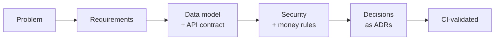

<div align="center">

🌐 **English** · [한국어](README.ko.md)


[](https://github.com/HoDoo7081/dooho-dev-portfolio/actions/workflows/validate.yml)


**[Projects](#-two-projects) · [Evidence](#-what-this-repo-shows) · [Honest scope](#-honest-scope) · [Contact](mailto:dksengh7081@gmail.com)**

</div>

## Design first, code second

I design the data model, API contract, security and money flows *before* anyone writes code.

> [!TIP]
> **Short on time? Read these two things (2 minutes).**
> 1. [How duplicate webhooks never double-charge](projects/fee-payment-link-mvp/docs/images/02-payment-confirmation-flow.png) — one diagram
> 2. [Why the database, not the app, enforces booking rules](projects/silverbridge-backend/docs/adr/ADR-001-db-enforced-states.md) — one decision record

Enterprise SaaS project and solutions-consulting background · KAIST PMBA (Data Science minor) · Korean / English / Mandarin.

### How I work



## 🧭 Four projects

### 🧭 SilverBridge — AI travel companion for seniors

<a href="projects/silverbridge-backend"></a>

| At a glance | |
|---|---|
| **Problem** | Only ~12% of parents try independent travel. The blocker is *fear*, not demand. |
| **Built** | PostgreSQL schema (**31 tables**), OpenAPI 3 contract (**14 paths**), role-permission matrix, PII retention table, SLOs, NestJS starter, **13 CI-run tests** proving the booking / webhook rules, AWS reference architecture, and the team's Stage 3 Android MVP write-up |
| **Key idea** | Enforce rules in the DB and the contract, not just in code |
| **My role** | CEO / strategy lead of a 4-person team. I designed the artifacts myself and used AI as a reviewer. |

**[Read the case study →](projects/silverbridge-backend)** · [Stage 3 MVP: shipped vs designed](projects/silverbridge-backend/docs/STAGE3-MVP.md) · [Running proof](projects/silverbridge-backend/reference-impl/README.md) · [AWS architecture](projects/silverbridge-backend/aws-reference-architecture/README.md) · [5 design decisions (ADR)](projects/silverbridge-backend/docs/adr/README.md)

### 💳 Fee Payment Link — card-payment links for club treasurers

<a href="projects/fee-payment-link-mvp"></a>

| At a glance | |
|---|---|
| **Problem** | Club dues are still bank transfers and spreadsheets. |
| **Built** | PRD, engineering guide, ledger / refund / settlement design, launch checklist, **launch program: milestones, dependency map, RAID log, RACI, go / no-go** |
| **Key idea** | A payment is confirmed only by a *verified webhook*. Every money event is an append-only ledger entry. |
| **My role** | Sole product and design author. AI as a reviewer. |

**[Read the case study →](projects/fee-payment-link-mvp)** · [Launch program (TPM)](projects/fee-payment-link-mvp/program/README.md) · [6 design decisions (ADR)](projects/fee-payment-link-mvp/docs/adr/README.md)

### 🛍️ Min Seoul — live cross-border K-beauty storefront

| At a glance | |
|---|---|
| **Problem** | Sell Korean skincare to customers in Taiwan and Asia: four languages, several currencies, customs ID, influencer-driven acquisition. |
| **Built** | Headless storefront (React 19 + TanStack Start on Cloudflare, Shopify Storefront API, Supabase), payments via Toss / PayPal / Airwallex / Payoneer, discount-link click analytics |
| **Key idea** | Let Shopify own checkout and compliance; own the market-specific front end. |
| **My role** | Integration and delivery lead on a client-designed build made with an AI app builder; payments, influencer acquisition, operations. Client code not published. |

**[Read the case study →](projects/minseoul-storefront/README.md)** · [minseoul.com (live)](https://minseoul.com)

### 💊 Ez-PAVE — interactive clinical card-news web app

| At a glance | |
|---|---|
| **Problem** | Static cards in a messaging feed are skimmed; the client wanted the key message to land through interaction. |
| **Built** | Figma cards → React web app: ratio-locked frame, background-first rendering, drag-to-reveal slider, link to the full article |
| **Key idea** | Keep the approved artwork pixel-faithful and add interaction as a thin overlay layer. |
| **My role** | Freelance, implementation only: AI-assisted build from the client's Figma and content; device testing; process report; candid accessibility review. Client and artwork not published. |

**[Read the case study →](projects/ez-pave-interactive-card/README.md)**

## 🔎 What this repo shows

| Skill | Evidence (click) |
|---|---|
| Turning a vague problem into requirements | [Fee Payment PRD](projects/fee-payment-link-mvp/01-PRD.md) · [SilverBridge problem framing](projects/silverbridge-backend/README.md) |
| Data modeling with enforced rules | [`schema.sql`](projects/silverbridge-backend/design-package/02_SQL/schema.sql) — 31 tables, CHECK / UNIQUE constraints, **validated by CI** |
| API contract design | [`openapi.yaml`](projects/silverbridge-backend/design-package/03_API/openapi.yaml) — idempotent bookings, signed webhooks |
| Security & privacy by design | [`SECURITY.md`](projects/silverbridge-backend/design-package/04_Security/SECURITY.md) — role matrix, retention & encryption table |
| Payments engineering judgment | [Payment confirmation flow](projects/fee-payment-link-mvp/docs/images/02-payment-confirmation-flow.png) · [ADR-005 refund state machine](projects/fee-payment-link-mvp/docs/adr/ADR-005-refund-state-machine.md) |
| Running evidence (not just docs) | [13 tests on PostgreSQL in CI](projects/silverbridge-backend/reference-impl/README.md): duplicate booking, seat race, idempotency, duplicate webhook, refund states — plus a mutation check |
| Program management | [Fee Payment launch program](projects/fee-payment-link-mvp/program/README.md): gates, dependency map, RAID, RACI, go / no-go |
| Shipping to production | [Min Seoul](projects/minseoul-storefront/README.md): a live cross-border storefront, with a ranked privacy and security review of my own delivered work |
| Front-end craft and accessibility review | [Ez-PAVE](projects/ez-pave-interactive-card/README.md): render-order and ratio-lock decisions, plus a P1/P2 accessibility review of my own delivery |
| Cloud architecture | [AWS reference architecture](projects/silverbridge-backend/aws-reference-architecture/README.md): security, scaling, cost assumptions, Well-Architected self-review, migration path, plus a [CDK proof stack](projects/silverbridge-backend/aws-reference-architecture/cdk/README.md) (CI-synthesized; not yet run in a live account) |
| Reading docs against code | [Stage 3 gap table](projects/silverbridge-backend/docs/STAGE3-MVP.md#4-honest-gap-table-documents-vs-code) |
| Decision-making & trade-offs | 11 [ADRs](projects/fee-payment-link-mvp/docs/adr/README.md) — context, decision, consequences, alternatives |

## 🧾 Honest scope

- **Design-first, with a small running proof.** The NestJS starter is a skeleton (no Prisma models yet, auth and webhook verification not implemented); each README lists the gaps.
- Targets and validation plans (e.g. interviews, beta test) are **plans, not results**.
- The Stage 3 Android MVP was built by the team with an AI design-to-code tool; I document what it does and does not do, and do not claim its code.
- AWS costs and the launch program are estimates and plans, labelled as such.
- UI screens are a **UI-kit-based draft** and are labeled as such.
- Client work (Min Seoul) is documented without its source code, tokens or customer data.
- No secrets, personal data, or employer/customer material is included.

<details>
<summary>Repository structure</summary>

```text
.
├── README.md / README.ko.md
├── docs/                          # shared images
├── .github/workflows/validate.yml # CI: schema loads (31 tables), seed, OpenAPI lint
└── projects/
    ├── silverbridge-backend/
    │   ├── design-package/        # ERD · SQL · OpenAPI · security · ops · test
    │   ├── process-models/        # L1/L2 process, swimlane, table dictionary (CSV)
    │   ├── api-starter/           # NestJS + Prisma skeleton
    │   └── docs/ (adr, images)
    ├── fee-payment-link-mvp/
    │   ├── 01-PRD.md … 04-FRONTEND-HANDOFF.md
    │   ├── program/               # launch plan, RAID, RACI, go / no-go
    │   └── docs/ (adr, images)
    ├── minseoul-storefront/       # case study only; client code not published
    └── ez-pave-interactive-card/  # case study only; client code not published
```
</details>
