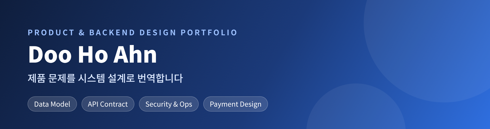
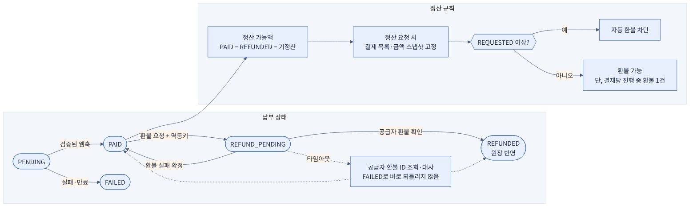

<div align="center">

🌐 **English** · [한국어](README.ko.md)



[](https://github.com/HoDoo7081/dooho-dev-portfolio/actions/workflows/validate.yml)


</div>

### I turn product problems into system design — data model, API contract, security, and money flows — *before* anyone writes code.

Enterprise SaaS project & solutions-consulting background · KAIST PMBA (Data Science minor) · Korean / English / Mandarin
This repo holds two end-to-end design packages. Each README states plainly what is designed, what is built, and what is not.

📧 [dksengh7081@gmail.com](mailto:dksengh7081@gmail.com)

---

## Start here — two projects

<table>
<tr>
<td width="50%" valign="top">

### 🧭 SilverBridge
**AI travel-companion platform for seniors** — backend design

<a href="projects/silverbridge-backend"></a>

- **Problem:** only ~12% of parents try independent travel — the blocker is *fear*, not demand
- **Built:** PostgreSQL schema (**31 tables**), OpenAPI 3 contract (**14 paths**), role-permission matrix, PII retention table, SLOs, NestJS starter
- **Key idea:** enforce rules in the DB and the contract, not just in code
- **Role:** CEO / strategy lead of a 4-person team; designed the artifacts myself, used AI as reviewer

[**Read the case study →**](projects/silverbridge-backend) · [5 design decisions (ADR)](projects/silverbridge-backend/docs/adr/README.md)

</td>
<td width="50%" valign="top">

### 💳 Fee Payment Link
**Card-payment links for club treasurers** — product & money-flow design

<a href="projects/fee-payment-link-mvp"></a>

- **Problem:** club dues are still bank transfers + spreadsheets
- **Built:** PRD, engineering guide, ledger / refund / settlement design, launch checklist
- **Key idea:** a payment is confirmed only by a *verified webhook*; every money event is an append-only ledger entry
- **Role:** sole product & design author; AI as reviewer

[**Read the case study →**](projects/fee-payment-link-mvp) · [6 design decisions (ADR)](projects/fee-payment-link-mvp/docs/adr/README.md)

</td>
</tr>
</table>

## What this repo shows

| Skill | Evidence (click) |
|---|---|
| Turning a vague problem into requirements | [Fee Payment PRD](projects/fee-payment-link-mvp/01-PRD.md) · [SilverBridge problem framing](projects/silverbridge-backend/README.md) |
| Data modeling with enforced rules | [`schema.sql`](projects/silverbridge-backend/design-package/02_SQL/schema.sql) — 31 tables, CHECK / UNIQUE constraints, **validated by CI** |
| API contract design | [`openapi.yaml`](projects/silverbridge-backend/design-package/03_API/openapi.yaml) — idempotent bookings, signed webhooks |
| Security & privacy by design | [`SECURITY.md`](projects/silverbridge-backend/design-package/04_Security/SECURITY.md) — role matrix, retention & encryption table |
| Payments engineering judgment | [Payment confirmation flow](projects/fee-payment-link-mvp/docs/images/02-payment-confirmation-flow.png) · [ADR-005 refund state machine](projects/fee-payment-link-mvp/docs/adr/ADR-005-refund-state-machine.md) |
| Decision-making & trade-offs | 11 [ADRs](projects/fee-payment-link-mvp/docs/adr/README.md) — context, decision, consequences, rejected alternatives |

### ⏱ 3-minute path
1. [Payment confirmation sequence](projects/fee-payment-link-mvp/docs/images/02-payment-confirmation-flow.png) — how duplicate webhooks never double-charge
2. [SilverBridge case-study table](projects/silverbridge-backend/README.md) — problem → approach → what I built
3. [ADR index](projects/fee-payment-link-mvp/docs/adr/README.md) — how I record trade-offs

## Honest scope

- **Design-first.** The NestJS starter is a skeleton (no Prisma models yet, auth and webhook verification not implemented); each README lists the gaps.
- Targets and validation plans (e.g. interviews, beta test) are **plans, not results**.
- UI screens are a **UI-kit-based draft** and are labeled as such.
- No secrets, personal data, or employer/customer material is included.

<details>
<summary>Repository structure</summary>

```text
.
├── README.md / README.ko.md
├── docs/                          # shared images
├── .github/workflows/validate.yml # CI: schema loads (31 tables), seed, OpenAPI lint
└── projects/
    ├── silverbridge-backend/
    │   ├── design-package/        # ERD · SQL · OpenAPI · security · ops · test
    │   ├── process-models/        # L1/L2 process, swimlane, table dictionary (CSV)
    │   ├── api-starter/           # NestJS + Prisma skeleton
    │   └── docs/ (adr, images)
    └── fee-payment-link-mvp/
        ├── 01-PRD.md … 04-FRONTEND-HANDOFF.md
        └── docs/ (adr, images)
```
</details>
