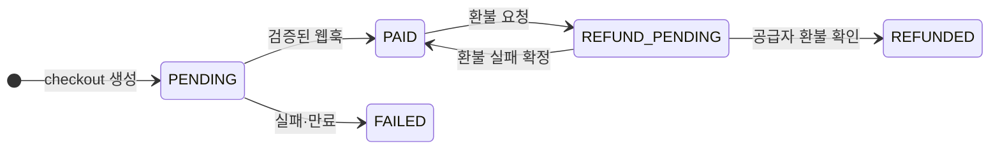

# 회비 결제 링크 (Fee Payment Link) — MVP 제품 & 백엔드 설계

<sub>🌐 [English](README.md) · **한국어**<br>[← Portfolio home](../../README.ko.md) · [← SilverBridge](../silverbridge-backend/README.ko.md) · **Fee Payment Link** · [ADRs](docs/adr/ko/README.md) · [PRD](ko/01-PRD.md) · [Engineering guide](ko/03-ENGINEERING-GUIDE.md)</sub>

| 6 | 3 | 7 | Docs stage |
|:-:|:-:|:-:|:-:|
| **ADRs** | **flow diagrams** | **launch-gate items** | **no code yet** |

> 모임 총무가 **3분 안에 카드 결제 링크**를 만들고, 납부 현황·환불·정산을 한 곳에서 관리하게 하는 서비스의 MVP 설계 문서 패키지입니다.

코드가 아니라 **문제 정의 → 요구사항 → 정책 → 상태 모델 → 백엔드 설계 원칙 → 출시 기준**까지를 한 벌로 정리한 제품·엔지니어링 문서입니다. 돈이 오가는 서비스에서 "무엇을 먼저 못 박아야 하는가"에 대한 제 접근을 보여주려는 목적으로 공개합니다.

> **TL;DR (EN)** — Product & money-flow design for card-payment links for club treasurers: PRD, verified-webhook payment confirmation, append-only ledger, refund state machine, settlement snapshots, 6 ADRs. Documentation stage only — no implementation yet. I authored the documents and used AI as a reviewer.

---

## 케이스 스터디 요약

| 항목 | 내용 |
|---|---|
| **문제** | 모임 회비는 아직 계좌이체와 엑셀로 관리됩니다. 입금 대조, 카드 결제 불가, 미납 파악, 환불·정산 장부 분리가 총무의 부담입니다. |
| **접근** | 총무는 3분 안에 결제 링크를 만들고, 회원은 **가입 없이** 카드 결제. 환불·정산까지 한 곳에서 관리. |
| **내가 만든 것** | PRD · 금액·상태·환불·정산 정책 · 엔지니어링 가이드 · 백엔드 과제서 · 프론트 핸드오프 · 운영·개인정보 기준 |
| **핵심 결정** | 검증된 웹훅으로만 결제 확정, 정수 원화 + bps, 추가 전용 원장, 환불 상태 머신, 정산 스냅샷 — [ADR 6건 보기](docs/adr/ko/README.md) |
| **현재 상태** | 문서(설계) 단계. 구현 코드와 실사용 지표는 없고, 아래 출시 승인 조건(7항목)이 구현 후 검증 기준입니다. |
| **목표 지표** | 링크 생성 3분 이내·성공률 99%↑, 웹훅 반영률 99.9%↑, 중복 납부 0건. *목표이며 달성한 수치가 아닙니다.* |

## 내 역할과 작업 방식

기획부터 문서화까지 **제가 직접 작성**했고, **AI를 검수자(리뷰어)로 함께 사용**했습니다.

| 영역 | 내가 한 일 |
|---|---|
| 문제 정의·요구사항 | 총무 관점의 페인포인트 도출, 성공 지표(링크 생성 3분, 중복 납부 0건 등) 설정 → `01-PRD.md` |
| 정책 결정 | 수수료 공식(정수 KRW, 절사), 정산 전 전액 환불 등 돈과 관련된 규칙 확정 |
| 설계 원칙 | 웹훅 검증 기반 결제 확정, 추가 전용 원장, 환불 상태머신, 정산 스냅샷 → `03-ENGINEERING-GUIDE.md` |
| 운영·개인정보 | 보관·파기, 운영 절차 정리 → `02-OPERATIONS-AND-PRIVACY.md` |
| 인수인계 | 백엔드 과제서와 프론트엔드 핸드오프 문서 작성 → `02-BACKEND-ASSIGNMENT.md`, `04-FRONTEND-HANDOFF.md` |

**AI 활용**: 초안과 의사결정은 직접 하고, AI는 정책 간 모순, 누락된 예외 상황(중복 웹훅, 부분 환불, 정산 후 환불 등), 용어 불일치를 점검하는 데 사용했습니다. 최종 판단과 책임은 제게 있습니다.

---

## 1. 해결하려는 문제

모임·동아리·학생회의 회비는 지금도 계좌이체와 엑셀로 관리됩니다.

- 총무가 입금 내역을 하나하나 대조해야 한다
- 납부자가 카드로 낼 수 없다
- 누가 냈고 누가 안 냈는지 파악하기 어렵다
- 행사가 취소되면 환불 기록과 정산 장부가 따로 논다
- 총무가 바뀌면 과거 회비·납부 기록 인수인계가 안 된다

## 2. 제품 목표와 성공 지표

| 제품 목표 | MVP 성공 지표 |
|---|---|
| 총무가 3분 이내에 일회성 회비 링크 생성 | 링크 생성 성공률 99% 이상 |
| 회원은 **가입 없이** 모바일 웹에서 결제 | 결제 성공 웹훅 반영률 99.9% 이상 |
| 결제 후 1분 이내 납부 목록 반영 | 중복 웹훅으로 인한 중복 납부 **0건** |
| 정산 전 결제는 전체 환불 가능 | 환불 요청과 결제사 환불 상태 불일치 **0건** |
| 모든 금액 변경을 변경 불가능한 원장 이벤트로 추적 | 총무가 납부자를 찾는 평균 시간 10초 이하 |

## 3. 사용자와 핵심 흐름

| 사용자 | 특징 |
|---|---|
| 총무 | 개인 사용자(사업자등록 없을 수 있음). 모임·회비 생성, 링크 공유, 환불·정산 요청 |
| 납부자 | 앱 가입 없이 링크로 접속, 이름·연락처 입력 후 카드 결제 |
| 운영자 | 이상 결제·환불·정산 검토, 필요 시 보류, 결제사와 내부 원장 대사 |

흐름: **총무 가입·모임 생성 → 회비 링크 생성 → 회원 결제 → (환불) → 정산 요청**

## 4. 핵심 설계 결정

### 4-1. 금액 정책 — 정수 원화, 서버만 신뢰

```text
platformFee  = floor(netAmount × platformFeeRateBps ÷ 10,000)
chargeAmount = netAmount + platformFee        # 기본 500 bps (5%)
```

`netAmount 100,000원 → platformFee 5,000원 → chargeAmount 105,000원`

- 소수점을 쓰지 않고 정수 원화로만 저장 → 반올림 오차 원천 제거
- 금액 계산은 서버만 수행 (클라이언트 값 불신)
- 결제 화면에서 "카드 수수료"라는 표현을 쓰지 않고, 플랫폼 서비스가 포함된 최종 결제금액을 명확히 표시
- PG 실비·Shopify 비용·부가세 표시는 별도 세무정책에 따르고, MVP는 `platformFee`를 단일 값으로 기록

### 4-2. 아키텍처 — 모듈형 모놀리스 + 결제 공급자 어댑터

```text
API ─ Auth · Organization · Campaign · Checkout · Payment · Refund · Settlement · Ledger · Admin
        ↓
Application Services → Domain + Repository Interfaces
        ↓
PostgreSQL / Shopify Adapter / Mock Provider
```

- 초기에는 마이크로서비스가 아니라 **모듈형 모놀리스**: 팀 규모와 MVP 속도에 맞춤
- Shopify는 주문·결제 상태 엔진으로만 쓰고, 모임·회원·회비·수수료·정산 장부는 **자체 백엔드가 소유**
- 결제 공급자를 도메인에서 분리해 두어, MVP 이후 국내 PG 직접 연동으로 **어댑터만 교체**할 수 있음


### 4-3. 결제 확정은 "리디렉션"이 아니라 "검증된 웹훅"

브라우저의 성공 URL은 사용자 안내용일 뿐입니다. 확정 처리는 아래 순서로 한 트랜잭션에서 수행합니다.

```text
verify signature
begin transaction
  insert provider_event(event_id) on conflict do nothing
  if duplicate: commit and return 200        # 중복 웹훅은 성공 응답 후 종료
  lock payment row
  validate amount / currency / campaign
  transition payment → PAID
  append ledger entries
  mark provider_event processed
commit
```

- 공급자 주문 ID·거래 ID에 유일 인덱스, 이벤트 ID를 **먼저 삽입**해 중복 처리 방지
- 웹훅 원문과 처리 결과는 감사용으로 기록하되 **카드정보는 저장하지 않음**

**결제 확정 시퀀스** — 성공 화면은 안내용이고, 확정은 서명 검증된 웹훅 + 이벤트 ID 선삽입(멱등)으로만 일어납니다.


### 4-4. 추가형(append-only) 원장

현재 잔액만 저장하지 않고 금액 사건을 모두 원장에 남깁니다: `PAYMENT_CAPTURED` · `PLATFORM_FEE_RECOGNIZED` · `REFUND_RESERVED` · `REFUND_COMPLETED` · `SETTLEMENT_RESERVED` · `SETTLEMENT_PAID` · `CHARGEBACK_RECORDED` · `MANUAL_ADJUSTMENT`.
수정·삭제 없이 반대 항목을 추가하고, 수동 조정에는 운영자·사유·관련 거래를 필수로 남깁니다.

### 4-5. 환불은 상태 머신 + 멱등키

외부 API 호출과 DB 저장을 한 트랜잭션으로 묶을 수 없으므로 상태를 단계로 나눕니다.
`PAID → REFUND_PENDING → (외부 환불 호출) → 성공 확인 → REFUNDED + 원장 반영`
**타임아웃 시 즉시 FAILED로 되돌리지 않고** 공급자 환불 ID 조회·대사 작업으로 최종 상태를 확인합니다. 환불 성공 전에는 원장을 차감 완료 처리하지 않습니다.

### 4-6. 정산 규칙

- 정산 가능액 = `PAID − REFUNDED − 이미 정산에 포함된 금액`
- 정산 요청 생성 시 대상 결제 목록과 금액을 **스냅샷으로 고정**
- `REQUESTED` 이상 정산에 묶인 결제는 자동 환불하지 않음 (정산 후 환불 차단)
- 동일 결제에 진행 중인 환불은 하나만 허용

**환불 상태 머신과 정산 규칙 한눈에 보기**


## 5. 상태 모델



| 대상 | 상태 |
|---|---|
| 캠페인 | `DRAFT` → `ACTIVE` → `CLOSED` / `CANCELLED` |
| 납부 | `PENDING` · `PAID` · `REFUND_PENDING` · `REFUNDED` · `FAILED` (`PARTIALLY_REFUNDED`는 정의만 하고 MVP UI에서는 생성하지 않음) |
| 정산 | `AVAILABLE` → `REQUESTED` → `PROCESSING` → `PAID` / `REJECTED` / `BLOCKED` |

## 6. 비기능 요구사항 요약

멱등성(생성·환불·정산 전부), 웹훅 서명 검증, 시간은 UTC 저장·ISO 8601 반환, 개인정보·계좌번호 평문 로그 금지, **외부 공급자 장애가 내부 트랜잭션을 손상시키지 않을 것**.

## 7. 출시 승인 조건 (Definition of Launch)

- [ ] Shopify 테스트 결제 성공 / 전체 카드 취소 성공
- [ ] 부분취소 가능 여부 확인 및 정책 결정
- [ ] 중복 웹훅 테스트 통과
- [ ] 결제 후 상품 가격이 바뀌어도 기존 주문 원장 불변
- [ ] 정산 후 환불 차단 테스트 통과
- [ ] PG·Shopify 수수료표 확인
- [ ] 운영자 대사 화면 또는 CSV 확인 가능

## 8. 문서 구성

| 문서 | 내용 |
|---|---|
| [01-PRD.md](ko/01-PRD.md) | 문제·목표·사용자·흐름·금액 정책·상태 모델·요구사항·출시 조건 |
| [02-BACKEND-ASSIGNMENT.md](ko/02-BACKEND-ASSIGNMENT.md) | 백엔드 개발자용 과제 안내, 제출물, 평가표 |
| [02-OPERATIONS-AND-PRIVACY.md](ko/02-OPERATIONS-AND-PRIVACY.md) | 운영·개인정보 기준 |
| [03-ENGINEERING-GUIDE.md](ko/03-ENGINEERING-GUIDE.md) | 아키텍처, Shopify 매핑, 결제 확정·원장·환불·정산 설계, 보안, 장애·대사 |
| [04-FRONTEND-HANDOFF.md](ko/04-FRONTEND-HANDOFF.md) | 프론트엔드 병렬 개발 가이드, 화면별 API 매핑 |
| [program/](program/README.md) | **TPM 산출물(영문)**: 출시 계획, 마일스톤·게이트, 의존성 맵, RAID 로그, RACI, go/no-go (실행 기록이 아닌 계획) |

## 9. 범위와 전제

- 현재 산출물은 **문서(설계)** 이며 구현 코드는 포함하지 않습니다.
- 대여금·예수금·수익 인식 등 회계 처리, PG·Shopify 계약상 비사업자 총무 대상 수납·정산 모델 승인, 약관·개인정보처리방침·환불정책은 출시 전 별도 검토가 필요합니다. 본 문서는 법률·세무 의견서를 대체하지 않습니다.
- 같은 설계 원칙(멱등성, 웹훅 검증, 상태 머신)은 [SilverBridge](../silverbridge-backend)의 결제·예약 설계와 연결됩니다.
