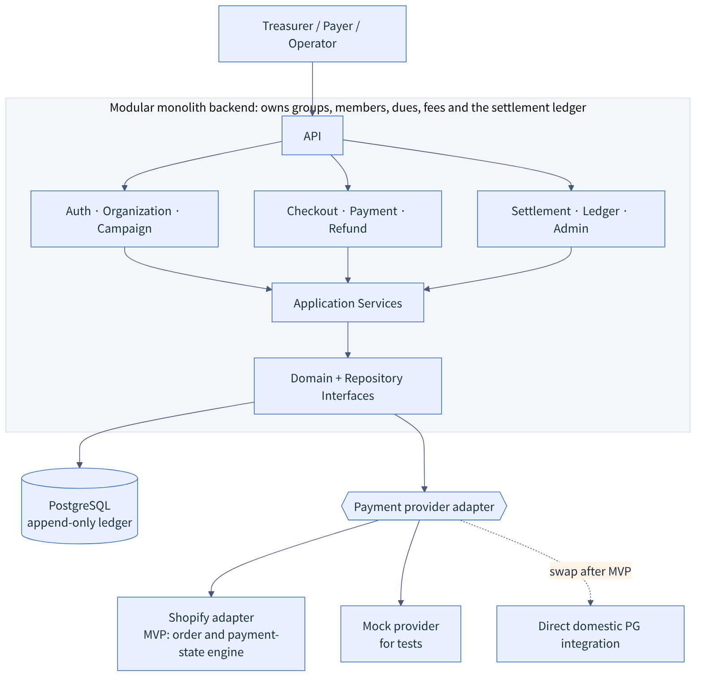
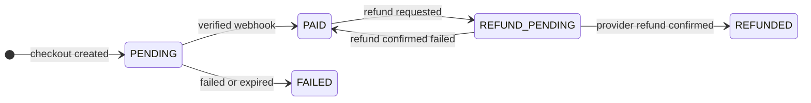

# Fee Payment Link — MVP product & backend design

<sub>🌐 **English** · [한국어](README.ko.md)<br>[← Portfolio home](../../README.md) · [← SilverBridge](../silverbridge-backend/README.md) · **Fee Payment Link** · [ADRs](docs/adr/README.md) · [PRD](01-PRD.md) · [Engineering guide](03-ENGINEERING-GUIDE.md)</sub>

| 6 | 3 | 7 | Docs stage |
|:-:|:-:|:-:|:-:|
| **ADRs** | **flow diagrams** | **launch-gate items** | **spec v1.0** |

> A documentation package for the MVP of a service that lets a club treasurer **create a card-payment link in 3 minutes** and manage payment status, refunds and settlement in one place.

This is not code. It is a set of product and engineering documents that runs from **problem definition → requirements → policy → state model → backend design principles → launch criteria**. I am publishing it to show my approach to a question that matters most in money-handling services: *what has to be nailed down first?*

> **TL;DR** — Product & money-flow design for card-payment links for club treasurers: PRD, verified-webhook payment confirmation, append-only ledger, refund state machine, settlement snapshots, 6 ADRs. Documentation stage; the later [build spec v1.0](05-BUILD-SPEC-v1.0.md) reports a Shopify adapter and a Lovable front end, not published here. I authored the documents and used AI as a reviewer.

---

## Case study at a glance

| | |
|---|---|
| **Problem** | Club dues are still managed by bank transfer and spreadsheet. Matching deposits, no card payment, tracking who has not paid, and keeping refunds and settlement in separate books all burden the treasurer. |
| **Approach** | The treasurer creates a payment link in 3 minutes; members pay by card **without signing up**. Refunds and settlement are managed in the same place. |
| **What I built** | PRD · policies for amounts, states, refunds and settlement · engineering guide · backend assignment · frontend handoff · operations and privacy criteria |
| **Key decisions** | Payment confirmed only by a verified webhook, integer KRW + bps, append-only ledger, refund state machine, settlement snapshot. [Read the 6 ADRs](docs/adr/README.md) |
| **Current status** | Documentation (design) stage plus a build spec v1.0 (2026-07-20) that moved to operator-issued links. The spec states a Shopify adapter and front end exist; that code is not published here and there is no real-usage metric. No domestic PG contract yet; the 7 launch-approval conditions below are the validation criteria once it is built. |
| **Target metrics** | Link creation within 3 min at ≥ 99% success; webhook reflection ≥ 99.9%; zero duplicate payments. *These are targets, not achieved numbers.* |

## My role and way of working

I **wrote everything myself**, from product planning to documentation, and **used AI as a reviewer**.

| Area | What I did |
|---|---|
| Problem definition and requirements | Surfaced the treasurer's pain points and set success metrics (3-minute link creation, zero duplicate payments, etc.) → `01-PRD.md` |
| Policy decisions | Fixed the money rules: fee formula (integer KRW, rounded down), full refund before settlement, and so on |
| Design principles | Webhook-verified payment confirmation, append-only ledger, refund state machine, settlement snapshot → `03-ENGINEERING-GUIDE.md` |
| Operations and privacy | Retention and disposal, operating procedures → `02-OPERATIONS-AND-PRIVACY.md` |
| Handoff | Backend assignment and frontend handoff documents → `02-BACKEND-ASSIGNMENT.md`, `04-FRONTEND-HANDOFF.md` |

**How I used AI.** Drafts and decisions are mine. I used AI to check for contradictions between policies, missed edge cases (duplicate webhooks, partial refunds, refund after settlement) and inconsistent terminology. Final judgment and accountability stay with me.

---

## 1. The problem

Dues for clubs, societies and student councils are still handled by bank transfer and spreadsheet.

- The treasurer has to reconcile every deposit by hand
- Payers cannot pay by card
- It is hard to tell who has paid and who has not
- When an event is cancelled, refund records and the settlement ledger drift apart
- When the treasurer changes, past dues and payment records are not handed over

## 2. Product goals and success metrics

| Product goal | MVP success metric |
|---|---|
| Treasurer creates a one-off dues link within 3 minutes | Link creation success rate ≥ 99% |
| Members pay on mobile web **without signing up** | Successful-payment webhook reflection ≥ 99.9% |
| Payment appears in the payer list within 1 minute | **Zero** duplicate payments caused by duplicate webhooks |
| Payments before settlement can be fully refunded | **Zero** mismatches between refund requests and provider refund status |
| Every amount change is tracked as an immutable ledger event | Average time for a treasurer to find a payer ≤ 10 s |

## 3. Users and core flow

| User | Notes |
|---|---|
| Treasurer | Individual user (may have no business registration). Creates groups and dues, shares the link, requests refunds and settlement |
| Payer | Opens the link without an app account, enters name and contact, pays by card |
| Operator | Reviews abnormal payments, refunds and settlements, holds them if needed, reconciles the payment provider against the internal ledger |

Flow: **treasurer signs up and creates a group → creates a dues link → member pays → (refund) → settlement request**

## 4. Key design decisions

### 4-1. Amount policy: integer KRW, trust only the server

```text
platformFee  = floor(netAmount × platformFeeRateBps ÷ 10,000)
chargeAmount = netAmount + platformFee        # default 500 bps (5%)
```

`netAmount 100,000 KRW → platformFee 5,000 KRW → chargeAmount 105,000 KRW`

- Amounts are stored only as integer KRW, with no decimals, which removes rounding error at the source
- Only the server calculates amounts; client values are not trusted
- The payment screen does not say "card fee"; it shows the final amount with the platform service included
- Actual PG costs, Shopify costs and VAT display follow a separate tax policy; the MVP records `platformFee` as a single value

### 4-2. Architecture: modular monolith with a payment-provider adapter

```text
API ─ Auth · Organization · Campaign · Checkout · Payment · Refund · Settlement · Ledger · Admin
        ↓
Application Services → Domain + Repository Interfaces
        ↓
PostgreSQL / Shopify Adapter / Mock Provider
```

- Start as a **modular monolith**, not microservices, to fit team size and MVP speed
- Shopify is used only as an order and payment-state engine; groups, members, dues, fees and the settlement ledger are **owned by our own backend**
- The payment provider is kept out of the domain, so after the MVP only the **adapter has to be swapped** to integrate a domestic PG directly



### 4-3. Payment is confirmed by a verified webhook, not by a redirect

The success URL in the browser is only for informing the user. Confirmation runs in one transaction in this order:

```text
verify signature
begin transaction
  insert provider_event(event_id) on conflict do nothing
  if duplicate: commit and return 200        # a duplicate webhook gets a success response and stops
  lock payment row
  validate amount / currency / campaign
  transition payment → PAID
  append ledger entries
  mark provider_event processed
commit
```

- Unique indexes on provider order ID and transaction ID, and the event ID is **inserted first**, to prevent duplicate processing
- The raw webhook and its result are recorded for audit, but **card data is never stored**

**Payment confirmation sequence.** The success screen is informational. Confirmation happens only through a signature-verified webhook plus event-ID-first insertion (idempotency).


### 4-4. Append-only ledger

Instead of storing only the current balance, every money event goes into the ledger: `PAYMENT_CAPTURED` · `PLATFORM_FEE_RECOGNIZED` · `REFUND_RESERVED` · `REFUND_COMPLETED` · `SETTLEMENT_RESERVED` · `SETTLEMENT_PAID` · `CHARGEBACK_RECORDED` · `MANUAL_ADJUSTMENT`.
Nothing is edited or deleted; a reversing entry is appended instead. Manual adjustments must record the operator, the reason and the related transaction.

### 4-5. Refunds are a state machine with idempotency keys

An external API call and a DB write cannot share one transaction, so the state is split into steps:
`PAID → REFUND_PENDING → (external refund call) → success confirmed → REFUNDED + ledger entry`
**On timeout the payment is not immediately returned to FAILED**; the final state is confirmed by looking up the provider refund ID in a reconciliation job. The ledger is not marked as reduced before the refund is confirmed.

### 4-6. Settlement rules

- Settleable amount = `PAID − REFUNDED − amount already included in a settlement`
- When a settlement request is created, the target payments and amounts are **frozen as a snapshot**
- Payments bundled into a settlement at `REQUESTED` or beyond are not auto-refunded (no refund after settlement)
- Only one in-flight refund is allowed per payment

**Refund state machine and settlement rules at a glance**


## 5. State model



| Object | States |
|---|---|
| Campaign | `DRAFT` → `ACTIVE` → `CLOSED` / `CANCELLED` |
| Payment | `PENDING` · `PAID` · `REFUND_PENDING` · `REFUNDED` · `FAILED` (`PARTIALLY_REFUNDED` is defined but not created in the MVP UI) |
| Settlement | `AVAILABLE` → `REQUESTED` → `PROCESSING` → `PAID` / `REJECTED` / `BLOCKED` |

## 6. Non-functional requirements (summary)

Idempotency (creation, refund and settlement alike), webhook signature verification, time stored in UTC and returned in ISO 8601, no plaintext personal data or bank account numbers in logs, and **a failure of the external provider must not corrupt internal transactions**.

## 7. Definition of Launch

- [ ] Shopify test payment succeeds / full card cancellation succeeds
- [ ] Confirm whether partial cancellation is possible and decide the policy
- [ ] Duplicate-webhook test passes
- [ ] Existing order ledger stays unchanged even if the product price changes after payment
- [ ] Refund-after-settlement block test passes
- [ ] PG and Shopify fee tables confirmed
- [ ] Operator reconciliation screen or CSV is available

## 8. Documents

| Document | Contents |
|---|---|
| [01-PRD.md](01-PRD.md) | Problem, goals, users, flow, amount policy, state model, requirements, launch conditions |
| [02-BACKEND-ASSIGNMENT.md](02-BACKEND-ASSIGNMENT.md) | Backend developer brief, deliverables, evaluation rubric |
| [02-OPERATIONS-AND-PRIVACY.md](02-OPERATIONS-AND-PRIVACY.md) | Operations and privacy criteria |
| [03-ENGINEERING-GUIDE.md](03-ENGINEERING-GUIDE.md) | Architecture, Shopify mapping, payment confirmation, ledger, refund and settlement design, security, failure and reconciliation |
| [04-FRONTEND-HANDOFF.md](04-FRONTEND-HANDOFF.md) | Parallel frontend development guide, screen-to-API mapping |
| [05-BUILD-SPEC-v1.0.md](05-BUILD-SPEC-v1.0.md) | **Latest baseline (2026-07-20)**: operator-issued links, fee tiers, locked pricing snapshots, provider adapter, 8 E2E scenarios, release-block rules; how it differs from the PRD |
| [program/](program/README.md) | **TPM view**: launch plan, milestones with exit gates, dependency map, [RAID log](program/RAID-LOG.md), [RACI and go / no-go](program/LAUNCH-READINESS.md) (a plan, not an execution record) |

> Korean originals of documents 01–04 are kept in [`ko/`](ko/).

## 9. Scope and assumptions

- The current deliverable is **documentation (design)**; no implementation code is published here (the build spec says a Shopify adapter and front end exist).
- Accounting treatment (loans, deposits received, revenue recognition), approval of the collection and settlement model for non-business treasurers under PG and Shopify contracts, and terms of service, privacy policy and refund policy all need separate review before launch. These documents do not replace legal or tax advice.
- The same design principles (idempotency, webhook verification, state machines) connect to the payment and booking design of [SilverBridge](../silverbridge-backend).
