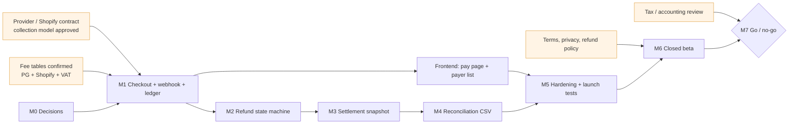

# Fee Payment Link — launch program (TPM view)

[← Fee Payment Link](../README.md) · [RAID log](RAID-LOG.md) · [Go / no-go & RACI](LAUNCH-READINESS.md)

> [!IMPORTANT]
> **This is a plan, not an execution record.** The product is at documentation stage. Durations are relative weeks (W0 = kickoff) and are estimates for a small team of ~1 PM, 1–2 backend, 1 frontend, 1 part-time operator. I wrote it to show how I would run the program; none of it has been executed.

## One-page summary

| | |
|---|---|
| **Goal** | Treasurers create a card-payment link in 3 minutes; payments, refunds and settlement tracked in one ledger |
| **Launch type** | Closed beta with 3–5 real clubs, then public MVP |
| **Critical path** | Provider decision → webhook + ledger → refund state machine → settlement snapshot → reconciliation → go / no-go |
| **Biggest unknowns** | Whether the payment provider / Shopify permits the treasurer-collects-and-settles model; whether partial cancellation is supported; tax treatment of the platform fee |
| **Exit criteria** | The 7 launch-approval conditions from the [PRD](../01-PRD.md), mapped to evidence in [LAUNCH-READINESS.md](LAUNCH-READINESS.md) |

## Phases and milestones

```mermaid
gantt
    title Fee Payment Link — planned phases (relative weeks, estimate)
    dateFormat  X
    axisFormat  W%s
    section Decide
    M0 Provider and policy decisions        :done, m0, 0, 2
    section Build
    M1 Checkout + verified webhook + ledger :m1, 2, 4
    M2 Refund state machine                 :m2, 6, 2
    M3 Settlement snapshot + payer list     :m3, 8, 3
    M4 Operator reconciliation (CSV)        :m4, 10, 2
    section Prove
    M5 Hardening + launch tests             :m5, 12, 2
    M6 Closed beta (3-5 clubs)              :m6, 14, 3
    section Launch
    M7 Go / no-go and public MVP            :milestone, m7, 17, 0
```

| # | Milestone | Exit gate (evidence, not activity) | Owner |
|---|---|---|---|
| M0 | Provider and policy decisions | Written answer on collection/settlement model, partial cancel, fee tables; ADR updated | PM |
| M1 | Checkout, verified webhook, ledger | Duplicate-webhook test green ([pattern proven here](../../silverbridge-backend/reference-impl/README.md)) | Backend |
| M2 | Refund state machine | Full card cancel succeeds in provider test mode; timeout path reconciles | Backend |
| M3 | Settlement snapshot, payer list | Refund-after-settlement block test green; list updates ≤ 1 min | Backend + Frontend |
| M4 | Operator reconciliation | Provider vs ledger diff produced as CSV, zero unexplained rows on test data | Operator + Backend |
| M5 | Hardening | Price change after payment leaves ledger unchanged; PII/log review done | Backend + PM |
| M6 | Closed beta | ≥ 3 clubs complete create → pay → settle; defect list triaged | PM |
| M7 | Go / no-go | All 7 conditions evidenced; open P1 risks = 0 | PM (decider), Legal/Finance consulted |

## Dependency map

Orange nodes are **external dependencies** the engineering team does not control; they are started in W0 because they have the longest lead time and are the most likely to move the date.

## How I would run it

- **Weekly**: one 30-minute risk review driven by the [RAID log](RAID-LOG.md), not a status meeting. Anything unowned gets an owner or is closed.
- **Gates, not dates**: a milestone is done when its evidence exists. The date moves; the gate does not.
- **Change control**: a scope change must state which milestone it delays or which item it replaces. (This mirrors how SilverBridge Stage 3 was [re-baselined](../../silverbridge-backend/docs/STAGE3-MVP.md).)
- **Early signal**: M1's duplicate-webhook test and M0's provider answer are the two earliest indicators of schedule health.
