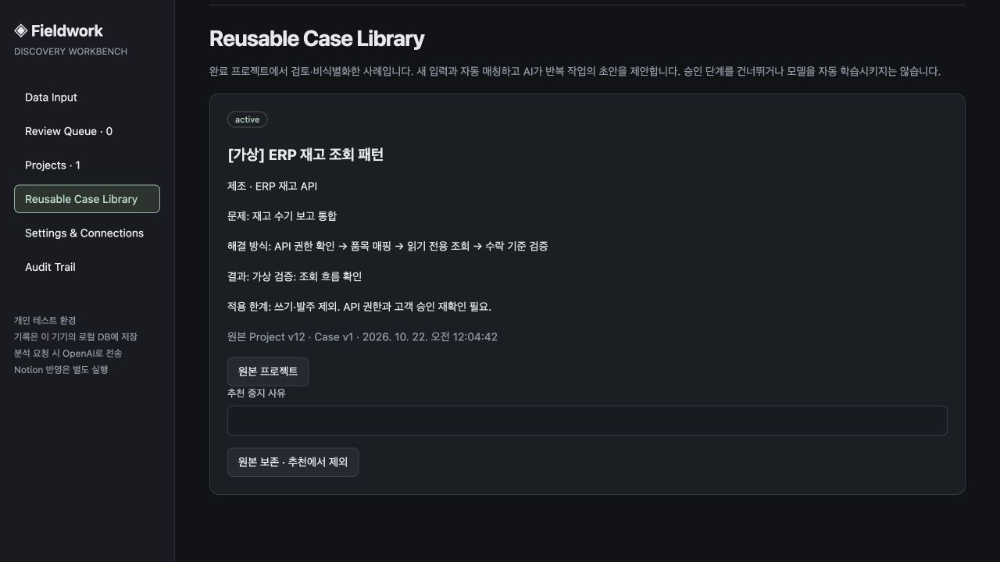

# Fieldwork — 고객 Discovery 업무 도구

[English](README.md) · [포트폴리오](../../README.ko.md)

**고객 미팅 → 근거 검토·승인 → 프로젝트 문서·후속 질문 → 재사용 플레이북**을 연결하는 개인용 로컬 앱입니다.

## 왜 만들었나

고객 미팅과 이메일을 정리하는 것만으로 다음 행동이 명확해지지는 않습니다. 확인된 요구, 추가 질문, 바뀐 조건, PoC 전에 합의할 사항을 매번 다시 구성해야 했습니다.

프리세일즈에서 경험한 반복 작업을 줄이고, 이전에 배운 것을 다음 고객 대응에 활용하고 싶어 별도의 개인 버전을 만들었습니다. 전 직장 코드·고객 데이터·내부 자료를 공개한 프로젝트가 아닙니다.

## 직접 한 일

업무 흐름과 검토·승인 규칙을 정의하고, AI 코딩 도구와 함께 구현·수정·테스트했습니다. 브라우저 UI, Node.js API, SQLite 기록, 구조화된 AI 제안, Notion 문서·작업 동기화, 완료 사례 재사용을 연결했습니다.

AI 출력은 제안으로만 저장하고 제가 원문을 검토한 뒤 승인합니다. 다음 단계에 필요한 정보가 확인되지 않으면 PoC 초안을 만들 수 없게 했습니다. 반복 사례는 검토·비식별 확인 후 플레이북으로 남기되 이전 고객의 수치와 승인을 새 고객에게 그대로 적용하지 않습니다.

## 구성

- Node.js 24+, 브라우저 JavaScript, SQLite. 추가 npm 패키지 없음.
- OpenAI 구조화 출력 어댑터와 채팅 JSON 수동 가져오기 경로.
- Notion REST API로 프로젝트·7개 문서·질문 작업·버전 스냅샷 반영.
- 로컬 감사 이력과 해시 체인. 외부 인증·전자서명은 아님.
- 키워드 기반 유사 사례 추천. 벡터 검색·모델 자동 학습은 아님.

## 검증 결과

개인 앱의 가상 데이터 UAT에서 검토 항목 9개(사실 5개·질문 4개)를 승인해 문서 7개와 연결 작업 4개를 생성했습니다. 재동기화 시 ID 유지·중복 없음, 미확인 질문에 따른 PoC 생성 차단을 확인했습니다.

이 UAT는 수동 JSON 가져오기 이후의 검토·Notion 반영을 검증했습니다. 유료 모델 호출·추출 품질·전체 고객 승인/완료/사례 재사용 주기를 검증한 결과는 아닙니다. 공개 버전의 Notion 설정은 사용자가 자신의 워크스페이스로 구성해야 합니다.

[실행·구조·코드](README.md) · [검증 근거](docs/VALIDATION.md) · [설정](docs/SETUP.md)

