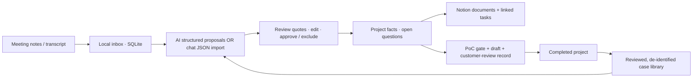

# Fieldwork — Discovery Workbench

[한국어](README.ko.md) · [Portfolio home](../../README.md) · [Validation evidence](docs/VALIDATION.md)

> **Customer conversations → reviewed requirements → project documents and next actions → reusable playbooks.**

A runnable, local, single-user presales workbench built with AI coding assistance. This is a **separate personal implementation**, motivated by repetitive discovery and documentation work I encountered in presales. It contains no former employer source code, customer records, credentials, or private workspace configuration.

## Why I built it

Customer needs and decisions arrive through meetings and email. Repeatedly reconstructing the project brief, open questions, PoC prerequisites and follow-up actions takes time. A summary alone does not tell me what was confirmed, what changed, or what to ask next.

I wanted to make that process repeatable without letting AI silently approve requirements. I also wanted completed work to become reviewed playbooks: reuse a useful approach, while rechecking each customer's data, constraints and approvals.

## What I did

- Defined the discovery-to-PoC workflow, source-evidence review rules, approval gates and reusable-case model.
- Used AI coding assistance to implement and iterate on a browser UI, local Node.js service, SQLite persistence, structured analysis adapter and Notion integration.
- Reviewed behavior through automated workflow tests and synthetic-data UAT; iterated on bulk review, document layout, template application and duplicate-free re-sync.
- Kept implemented behavior separate from unverified model quality and future production requirements.

## How it works



| Component | Implementation |
|---|---|
| Interface | HTML/CSS/browser JavaScript; local HTTP API |
| Server | Node.js 24+, native modules; binds to 127.0.0.1 |
| Storage | SQLite for state and append-only application audit history |
| AI adapter | OpenAI Responses API, structured JSON schema; optional, not needed for local tests |
| No-API path | Copy analysis request into a chat, import its JSON result, then review every item |
| Notion | Official REST API; project template, seven document sections, version snapshots and linked question tasks |
| Reuse | Keyword-based case recommendations, explicitly selected as reference context; no vector database or model training |

## Controls that matter

- **AI proposals stay pending.** Saving or importing notes does not create an approved project.
- **Sources remain inspectable.** Exact quote matching helps review but cannot prove a customer's statement is true.
- **Changes need review.** Preserve original proposals, review notes and superseded facts.
- **PoC drafting is gated.** Open questions or unapplied follow-ups block it.
- **Approval is version-specific.** Editing a PoC returns it to draft.
- **Reuse is bounded.** Completed cases require a de-identification confirmation and retain source-version links.
- **Audit is local.** SHA-256 chaining and SQLite triggers detect application-level changes; they are not external immutable storage or authenticated electronic signatures.

## Quick start — no credentials required

```bash
git clone https://github.com/HoDoo7081/dooho-dev-portfolio.git
cd dooho-dev-portfolio/projects/fieldwork-discovery-workbench
node --version  # Node.js 24 or newer
npm test
npm run check
npm start
```

Open **http://127.0.0.1:4317**. There are no npm dependencies to install. Use the clearly labelled [synthetic transcripts](uat/) for exploration. All generated data stays in the ignored local data folder unless you explicitly use an external analysis or Notion connection.

For the chat import path: save an input → prepare/copy the analysis request → obtain JSON in a chat of your choice → import it → review → apply. The chat step sends the content you paste to that service and is manual, not an automatic connection.

Optional integrations: copy [.env.example](.env.example) to `.env.local`, then see [setup](docs/SETUP.md). No shared Notion workspace or personal IDs are included.

## Demonstrated results and limits

A prior synthetic-data UAT of the personal app used the **manual JSON import path**: five facts and four questions were reviewed; approval created seven structured Notion documents and four linked tasks. Re-sync preserved document/task IDs; unresolved questions blocked PoC drafting.

That result tests review and Notion synchronization. It does **not** establish live model extraction accuracy, the entire completion/reuse lifecycle, customer acceptance, business savings or production scalability. The published configurable version passed **18/18 automated tests** and syntax checks; a reader's own Notion environment still requires setup and integration verification.


*Personal app screenshot with a clearly labelled synthetic inventory case. The result is not a real customer outcome.*

## A concrete review-and-sync example

In the synthetic-data UAT, imported proposals started pending. Five source-backed facts were selected for approval while four questions stayed pending; the questions were reviewed separately before project creation. Applying the reviewed set produced seven structured Notion documents and four linked tasks.

Re-sync preserved the existing document/task IDs. The four unresolved questions still prevented PoC drafting: approving a question for tracking did not mean its answer had been confirmed. This distinction keeps a complete-looking document from being mistaken for readiness to proceed.

**Why the playbook matters:** the reusable asset is the problem pattern, approach, verified outcome and limitations—not an old customer's transcript, approval or target metric. I keep that boundary explicit when applying a case to a new engagement.

## Read the code

- [Review and workflow rules](src/core.mjs)
- [Structured AI adapter](src/ai.mjs)
- [Bound chat JSON import](src/manual.mjs)
- [Notion synchronization](src/notion-sync.mjs)
- [Playbook/case reuse](src/library.mjs)
- [Audit history](src/audit.mjs)
- [Automated tests](test/)

## Current boundaries

Local personal MVP, with a Korean UI and English documentation. No hosted demo, enterprise SSO, multi-user authorization, at-rest encryption, or bidirectional Notion editing. A crash between a remote write and local checkpoint can still create duplicate remote objects; normal repeated synchronization was tested, not every crash/retry boundary. Live model calls previously hit a credit limit; extraction quality is not a demonstrated result. No benchmark time-saving percentage is claimed.

