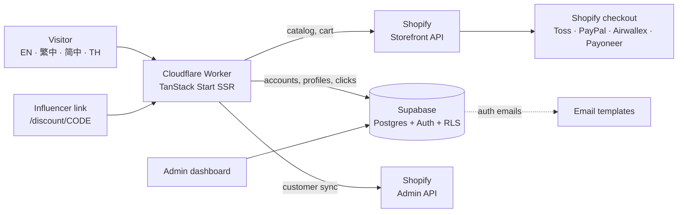

# Min Seoul — headless K-beauty storefront (client project, live)

🌐 **English** · [한국어](README.ko.md) [← Portfolio home](../../README.md) · **Min Seoul** · [SilverBridge](../silverbridge-backend/README.md) · [Fee Payment Link](../fee-payment-link-mvp/README.md)

| 3 | 4 | 5 | 1 |
|:-:|:-:|:-:|:-:|
| **K-beauty brands + own line** | **UI languages** | **display currencies** | **live production site** |

> A real, **live** cross-border e-commerce site for Korean skincare brands, aimed at customers in Taiwan and other Asian markets: **[minseoul.com](https://minseoul.com)**. It is client work, so the source code is **not published**; this page documents the architecture, what I did, and what I would fix.

> **TL;DR** — Headless storefront: React 19 + TanStack Start on Cloudflare, Shopify Storefront API for catalog and checkout, Supabase for accounts and analytics. Multi-language, multi-currency, a Taiwan customs-ID flow, and an influencer discount-link funnel. Built with an AI app builder (Lovable) from the client's Figma; I directed the build and integrated payments and Shopify. My project work is complete; the customer site remains publicly accessible.

---

## Case study at a glance

| | |
|---|---|
| **Engagement** | Completed freelance engagement. Proposal and initial build plan dated May 2026; subsequent maintenance and added scope are part of the delivered project history |
| **Client / product** | Min Seoul (formerly Purève Seoul): curated K-beauty brands plus an own-label line, sold cross-border |
| **Problem** | Sell Korean skincare to overseas customers who read different languages, pay in different currencies and, in Taiwan, must provide a customs ID. Acquire customers through influencers and measure which ones work. |
| **What shipped** | Product catalog and product-detail stories, cart, checkout hand-off to Shopify, customer accounts, order history and tracking, contact form, admin discount-link analytics, auth emails |
| **Stack** | React 19 · TanStack Start (SSR) · Cloudflare Workers · Tailwind 4 · Shopify Storefront and Admin APIs · Supabase (Postgres, Auth, RLS) |
| **My role** | Integration and delivery lead on a build the client designed in Figma. Details in the next section. |
| **Evidence** | Live site · 9 database migrations · ~4,700 lines of server and route code across 22 routes · my own delivery documents (proposal with definition of done, daily progress report, influencer-tracking user guide), summarised below. Business results (revenue, conversion) are the client's and **not claimed here**. |

## My role and how I worked

| Area | What I did |
|---|---|
| Build | Turned the client's Figma into a working site with **Lovable** (AI app builder), reviewing, correcting and extending the generated code. I am not claiming hand-written application code. |
| Commerce integration | Wired the catalog, cart and checkout to Shopify; resolved CORS and domain issues during the rebrand from purveseoul.com to minseoul.com |
| Payments | Set up cross-border payment acceptance: Toss as the card provider, plus PayPal, Airwallex and Payoneer (including routing PayPal through a US entity). This is configured on the Shopify and provider side and is **not in the code snapshot**. |
| Planning and reporting | Wrote the proposal with its acceptance criteria and 5-day plan, and the daily status report to the client (see the documents above) |
| Customer acquisition | Built a Taiwan Instagram influencer list, ran outreach and meetings, negotiated terms, issued influencer-specific discount codes, and set up the click tracking plus the user guide described below. Counts (influencers contacted, contracts, orders per code) are **not stated here** because I have no figures to cite yet. |
| Maintenance history | Provided support; a later signed scope added an **ingredient editor** (not part of the reviewed snapshot). This does not describe a currently active engagement. |

## Implementation walkthrough

**Customer problem → connected workflow → outcome.** The client supplied the Figma design; I led its AI-assisted implementation and integration so overseas customers could browse products, use accounts and proceed to Shopify checkout. Lovable generated code; my work was directing, reviewing and refining the build, connecting systems, configuring services and handling delivery issues.

| Integration boundary | Concrete implementation | Why it matters |
|---|---|---|
| UI input → Shopify Cart API | Normalize country-name values before submitting them to Shopify | A readable UI label is not automatically a valid API value |
| Influencer link → cart | Capture the code, retain it in a 30-day cookie, and apply it when creating the Shopify cart | Connect referral entry with the customer's purchase flow |
| Custom account → Shopify customer | Find or create the customer by email and synchronize the profile on the server | Connect the application account with commerce records |
| Shopper-facing → privileged operations | Storefront API for products/cart/checkout; server-side Admin API for customer sync and order retrieval | Keep privileged credentials out of the browser |

**Demonstrable result:** the delivered storefront and connected shopping workflows, plus proposal, progress-report and handover materials summarized below. Revenue uplift, conversion improvement and the original five-day delivery target are not verified results.

The domain/CORS resolution is part of my delivery history. This public case does not contain a request-level incident log, so it does not invent a particular error response or header change. The snapshot review below separately identifies remaining CORS hardening work.

## Delivery documents I wrote (summarised; originals are the client's)

| Document | What it contains | Why it matters |
|---|---|---|
| **Project proposal / PRD (v1.0)** | Goal and background, tech stack, 6 screens with priorities, interaction specs (hover zoom `scale(1.08)` over 0.35 s; variant image swap with a 0.25 s fade), a **5-day build plan** with a deliverable per day, Shopify product-CSV column spec, collection handles, and **7 measurable success criteria** (for example: responsive from 375 to 1440 px, Lighthouse performance ≥ 70, ≥ 80% visual match to Figma) | Scope, schedule and acceptance criteria agreed before building |
| **Daily progress report (Day 1)** | Headline status tiles; a per-screen table (done / partial / planned, with notes); what was verified on each screen; the remaining days; and **five explicit asks of the client** (final product names, brand colours, real product photos, store access for the API, currency decision) | Status reporting that surfaces what blocks the next day |
| **Influencer tracking user guide (6 pages)** | How to create a discount code, the exact link format to hand to an influencer, how clicks and the 30-day cookie work, where to read sales (Shopify discount performance and "Sales by discount" report), how to compute conversion (orders ÷ clicks), a FAQ, and a list of known limits | Hand-over documentation so non-engineers can run the funnel |

Plan versus actual, stated plainly: the proposal's 5-day plan (May 2026) covered the **first storefront**. The Day 1 report shows six screens built with mock data, and the Shopify connection and real photos still pending. I do not have a Day 5 launch report, so I do not claim the launch hit its target date. The current site has since grown well beyond that plan (accounts, tracking, multi-language, a rebrand).

## Architecture

**Why headless?** Shopify handles the parts that must be right and compliant (checkout, payments, tax, orders). The custom front end handles the parts Shopify themes do poorly: four languages, per-visitor currency display, a Taiwan pre-checkout step, and a first-party influencer funnel. The cost is two systems to keep in sync, which is where most of the issues below come from.

## Features worth knowing about

| Feature | How it works |
|---|---|
| **Multi-language, multi-currency** | UI in English, Traditional Chinese, Simplified Chinese and Thai. Prices are registered in Shopify in USD and converted with fixed rates for display in KRW, USD, TWD, CNY and THB. Product-detail copy is translated from a ~650-entry dictionary applied to the rendered text. |
| **Taiwan customs-ID step** | Before checkout, a gate asks for the destination country; for Taiwan it collects the customs ID (EZ Way). The ID is attached to the Shopify cart attributes and the customer record so the carrier can clear the parcel. |
| **Influencer discount links** | `/discount/CODE` records the click (code, referrer, user agent, IP), stores the code in a 30-day cookie, and the code is applied automatically at cart creation. An admin-only dashboard shows clicks, unique IPs and last-7-day trend per code. Sales per code are read in Shopify (discount performance and "Sales by discount"); conversion = orders ÷ clicks, calculated by hand as the [user guide](#delivery-documents-i-wrote-summarised-originals-are-the-clients) describes. |
| **Accounts** | Supabase Auth with a profile row created by a database trigger; row-level security limits each user to their own profile; roles live in a separate table with a `has_role` security-definer function (the pattern that avoids privilege-escalation via the profile table). |
| **Shopify customer sync** | On profile save, the customer is found-or-created in Shopify (matched by email) and its address and notes are updated. |
| **Order history and tracking** | Orders are read from Shopify on the server and shown in the account area, with a tracking page. |
| **Server-side validation** | Server functions validate input (for example the analytics window is clamped to 1–365 days) and check the admin role on the server, not in the browser. |

## What is good, and what I would fix

I reviewed the code snapshot as I would review a client's system. The first column is what holds up; the second is a candid list of issues, ranked by how much they matter.

| Holds up | Needs fixing (priority) |
|---|---|
| Secrets (Shopify admin token, Supabase service key, email API key) are read from server environment variables, not shipped to the browser | **P1 — Customs ID stored in plaintext.** The Taiwan ID is a government identifier. It sits unencrypted in `profiles` and is copied into Shopify notes. It needs field-level encryption or a retention rule, and a privacy-policy line. |
| Row-level security enabled on every table; per-user policies on profiles; admin check on the server | **P1 — IP addresses stored with no stated retention.** `discount_clicks` keeps raw IPs. Hash them or purge after N days, and disclose it. |
| Roles in a separate table, not on the profile | **P2 — Open insert policy on click and contact tables.** Anyone can insert, so the tables can be spammed. Add rate limiting or a captcha on the contact form. |
| Cart-level discount code applied server-trusted by Shopify (the client cannot invent a discount) | **P2 — Storefront token and store domain are hard-coded** in a proxy route that also allows any origin (CORS `*`). The Storefront token is designed to be public, but should still come from configuration, and the proxy should restrict origins. |
| Input validation and clamping in server functions | **P2 — An admin user ID is hard-coded in a migration.** Seed admins out-of-band instead of in versioned SQL. |
| Country-name normalisation before sending to Shopify (the Cart API rejects free-text countries) | **P3 — Exchange rates are constants in code** (calibrated to target display prices), so displayed prices drift from real rates and can differ from the amount charged at checkout. Use a daily-updated rate table, and show the checkout currency clearly. |
| | **P3 — Conversion is a manual calculation.** (Update: tracking is now read in Shopify, per the site owner.) By design the dashboard shows clicks and Shopify shows sales (the guide documents this split). An orders webhook that joins orders to codes would show conversion and ROI per influencer in one place. The guide also lists real limits: cookies fail in private mode and across devices, and a code created in Shopify must match the link's spelling. |
| | **P3 — Translation by dictionary** only covers known strings; untranslated product copy falls back to English. A managed translation workflow would scale better. |

## What this demonstrates

- Shipping to production under a client brief, not only designing on paper
- Cross-border commerce knowledge: multi-currency display, customs identifiers, several payment providers, discount-code funnels
- Choosing a headless architecture on purpose, and naming its costs
- Reviewing a system for privacy and security risk and ranking the findings, including in work I delivered

## Honest scope

- Freelance client project: the code, store domain, tokens, customer data and revenue figures are not published.
- Built with an AI app builder from the client's design. My contribution is direction, integration, payments, acquisition work and operations, not hand-typed application code.
- Payment-provider setup, influencer contracts and the ingredient editor are described from my own work but are **not visible in the reviewed code snapshot**. The three documents above are the evidence I can show for planning, reporting and operations.
- The proposal's success criteria were all marked "to be verified" at the time; I do not have a recorded result for them.
- The issues list is a review of the snapshot. Some may already be fixed in production.
