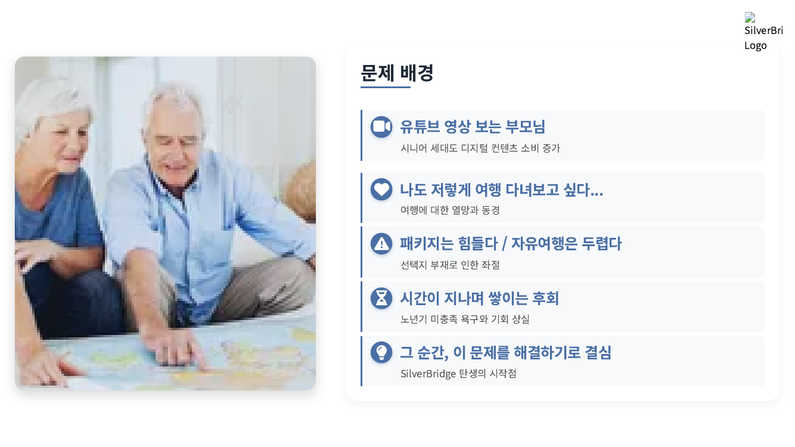
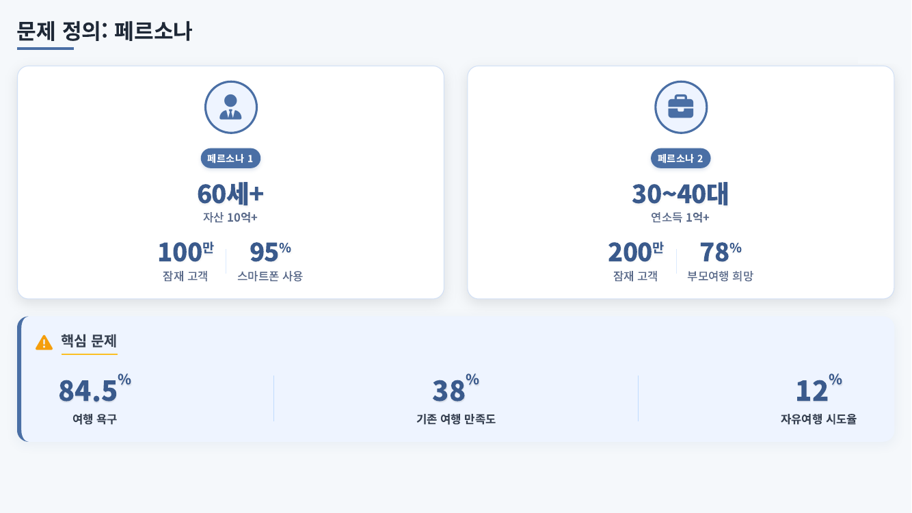
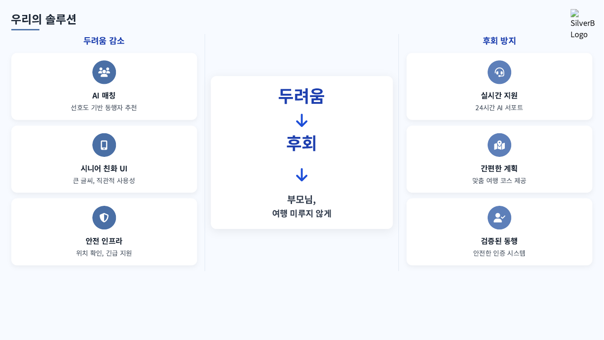
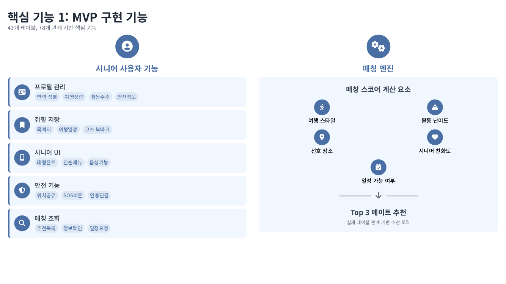
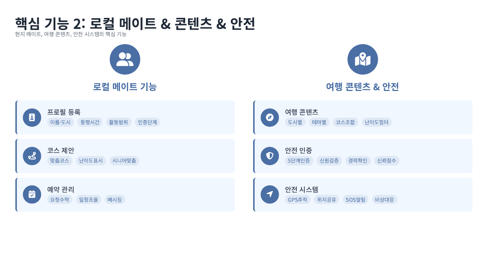
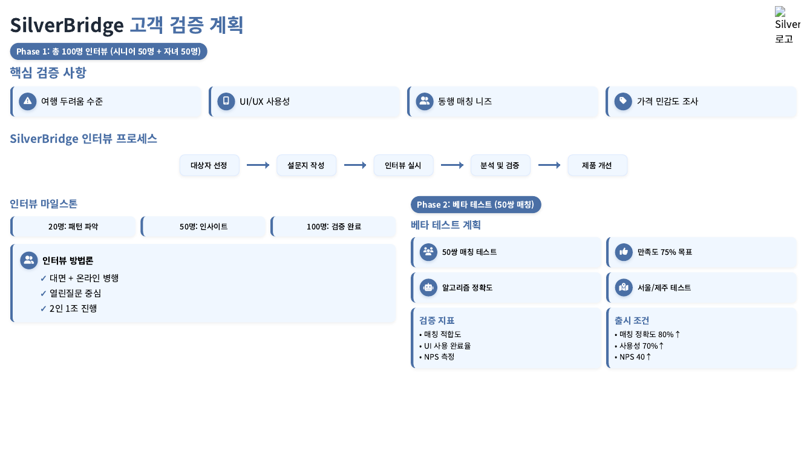
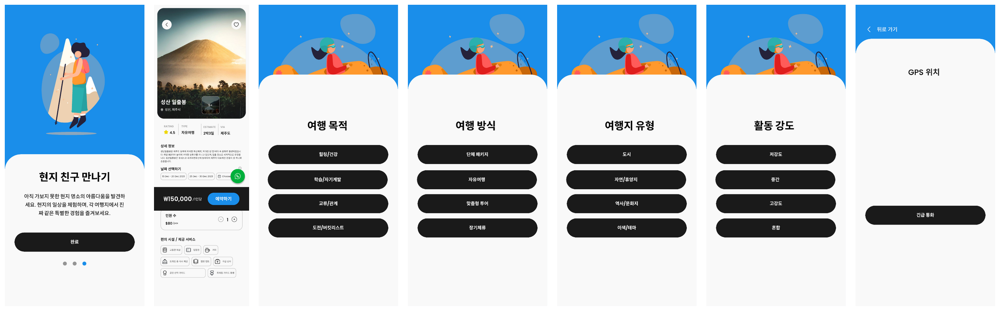
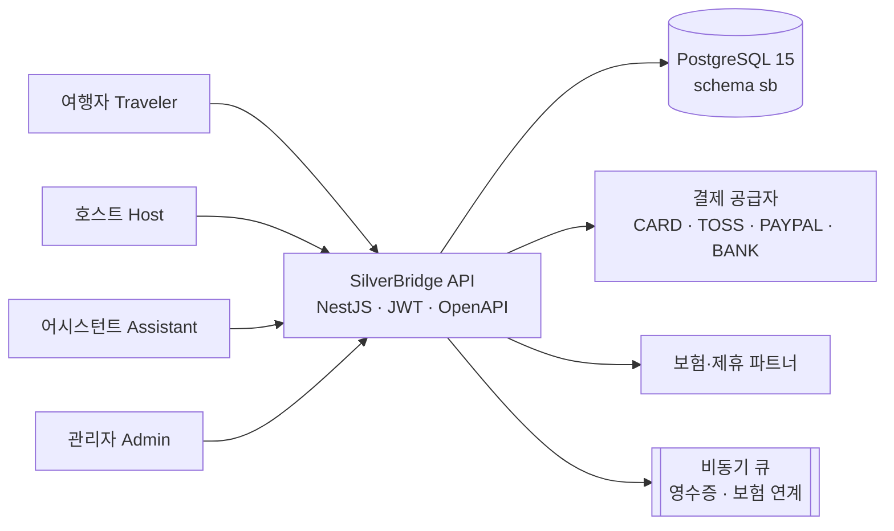
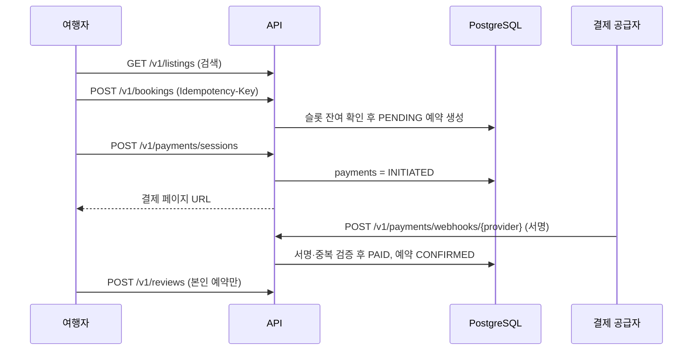

# SilverBridge — 시니어 부모님 자유여행 AI 동행 플랫폼 (Backend 설계 & API 스타터)

<sub>🌐 [English](README.md) · **한국어**<br>[← Portfolio home](../../README.ko.md) · **SilverBridge** · [Fee Payment Link →](../fee-payment-link-mvp/README.ko.md) · [ADRs](docs/adr/ko/README.md) · [Schema](design-package/02_SQL/schema.sql) · [OpenAPI](design-package/03_API/openapi.yaml)</sub>

| 31 | 14 | 5 | CI ✓ |
|:-:|:-:|:-:|:-:|
| **DB tables** | **API paths** | **ADRs** | **schema + API validated** |

> "패키지는 힘들고, 자유여행은 두렵다." 시니어의 이 두려움을 **AI 동행 매칭 + 실시간 안전 인프라**로 줄이는 여행 플랫폼의 백엔드 설계 산출물입니다.

KAIST App 창업 프로그램에서 PMBA 동료 4인 팀(제하팀)으로 진행한 프로젝트이며, 이 폴더에는 **데이터 모델(PostgreSQL) · API 계약(OpenAPI) · 보안/운영/테스트 설계 · 업무 프로세스 모델 · NestJS API 스타터**가 들어 있습니다.
팀 내 역할: **CEO · 전략 책임** (팀 IR 피치덱 기준) — 아래 「내 역할과 기여」 참고.

> **TL;DR (EN)** — Backend design for an AI travel-companion platform for seniors: 31-table PostgreSQL schema with DB-enforced rules, OpenAPI 3 contract, role/PII/SLO design, 5 ADRs. Design-first; the NestJS starter is a skeleton (gaps listed in §10). I authored the artifacts and used AI as a reviewer.

---

## 케이스 스터디 요약

| 항목 | 내용 |
|---|---|
| **문제** | 부모 세대의 자유여행 시도율은 약 12%. 병목은 수요가 아니라 *두려움*(길 잃음·응급상황)이고, 결제자(자녀)와 이용자(부모)가 다릅니다. |
| **접근** | AI 동행 매칭 + 실시간 안전 인프라 + 시니어 친화 UI. 이원 사용자(여행자·호스트·어시스턴트·관리자)를 처음부터 설계. |
| **내가 만든 것** | 프로세스 모델 → 31개 테이블 스키마 → OpenAPI 3 계약 → 권한·개인정보·SLO·테스트 설계 → NestJS 스타터 |
| **핵심 결정** | 규칙을 코드가 아니라 **DB 제약과 계약으로 강제** — [ADR 5건 보기](docs/adr/ko/README.md) |
| **현재 상태** | 설계 산출물 완료, 구현은 스타터 수준(아래 10장 한계 참고). 스키마·API 계약은 [CI로 자동 검증](../../.github/workflows/validate.yml)됩니다. |
| **검증 계획** | 시니어·자녀 100명 인터뷰 → 50쌍 베타 테스트 (목표: 만족도 75%↑, 매칭 정확도 80%↑). *계획이며 달성한 수치가 아닙니다.* |

## 내 역할과 기여

이 저장소의 SilverBridge 산출물(프로세스 모델, 데이터 모델, API 계약, 보안·운영·테스트 설계, NestJS 스타터)은 **제가 직접 설계·작성**했고, **AI를 검수자(리뷰어)로 함께 사용**했습니다. 사업·전략 책임자가 *무엇을, 왜, 어떤 순서로 만들지*를 결정하고, 그것을 개발팀이 바로 구현할 수 있는 문서와 코드 골격으로 끝까지 옮긴 사례입니다.

| 영역 | 내가 한 일 | 이 저장소에서 확인할 곳 |
|---|---|---|
| 문제 정의·시장 논리 | 시니어 자유여행의 병목을 '수요'가 아닌 '두려움'으로 정의, 결제자(자녀)·이용자(부모) 이원 사용자 구조 도출 | 아래 1장, 팀 IR 피치덱 |
| 제품 범위·프로세스 설계 | 매칭·안전(SOS/체크인)·예약/결제를 핵심 흐름으로 확정, L1·L2 프로세스와 스윔레인 작성 | `process-models/` |
| 데이터 모델링 | 31개 테이블 설계, 예약·결제 상태와 중복 예약·좌석 한도를 DB 제약으로 명문화 | `design-package/02_SQL/`, 아래 4장 |
| API·보안·운영 설계 | OpenAPI 3 계약, 역할×엔드포인트 권한 매트릭스, 개인정보 보존·파기표, SLO, 테스트 전략 작성 | `03_API/`, `04_Security/`, `05_Operations/`, `06_Test/` |
| 구현 착수 상태로 인수인계 | NestJS + Prisma 스타터로 설계가 코드로 이어지는 골격 제공 | `api-starter/` |

### AI 활용 방식
- **작성은 제가, 검증은 AI와 함께**: 설계 초안과 의사결정은 직접 하고, AI에게는 누락(제약·인덱스·권한 구멍), 문서 간 불일치(SQL ↔ OpenAPI ↔ 권한표), 엣지 케이스를 점검시키는 용도로 썼습니다.
- 이 방식으로 *혼자서도 전문 영역(DB·보안·운영)의 설계 품질을 팀 수준으로 끌어올리는 워크플로*를 만들었고, 최종 판단과 책임은 제게 있습니다.

**솔직한 범위 표기**: NestJS 스타터는 구현 완성본이 아니라 골격입니다(미구현 항목은 아래 10장 '현재 상태와 한계'). 프로덕션 백엔드 운영 경험으로 읽히지 않도록 의도적으로 명시했습니다. 제가 보여드리려는 역량은 **요구사항을 데이터 모델·API·보안·운영 설계로 번역하고, 구현 한계까지 스스로 점검하는 능력**입니다.

---

## 한눈에 보기 — 팀 산출물 (직접 제작)

> 설계 문서의 출발점이 된 문제 정의·솔루션·업무 프로세스 자료입니다. 팀 IR 피치덱(2025-11)과 Lucid 프로세스 맵에서 발췌했습니다.

**업무 프로세스 L1 — 5개 주체(여행자·로컬 프렌드·플랫폼·파트너·관리자) × 7단계 스윔레인.** 이 흐름이 `sb` 스키마의 테이블과 API 엔드포인트로 이어집니다.


| 문제 → 해결 | |
|---|---|
|  |  |
|  |  |
|  |  |

### UI 시안 (draft v1.0)

온보딩 → 상품 상세 → 취향 선택(여행 목적·방식·유형·활동 강도) → 안전(GPS 위치·긴급 통화)으로 이어지는 시니어 대상 모바일 화면 흐름입니다. 취향 4문항은 매칭 알고리즘 입력값(`travel_style`·활동 수준 등)과 대응됩니다.



> **출처 표기**: 상용 모바일 UI 키트(Figma Community)를 기반으로 SilverBridge 서비스 흐름에 맞게 한글화·화면 구성한 **시안(draft)** 입니다. 제 디자인 역량을 보여주는 자료가 아니라, 설계 문서가 실제 화면 흐름으로 어떻게 이어지는지 보여주는 참고 자료로 넣었습니다.

---

## 1. 왜 만들었나 — 문제 정의

팀 IR 피치덱(2025-11)에서 정리한 문제 구조입니다 (수치는 덱에 인용된 값).

| 관찰 | 의미 |
|---|---|
| 부모 세대의 여행 욕구는 크지만 자유여행 시도율은 약 12% | 하고 싶지만 못 한다 — 수요가 아니라 **두려움**이 병목 |
| 기존 시니어 여행 서비스 만족도 약 38% | 패키지 중심 시장에 선택지가 부족 |
| 65세 이상의 74.1%가 온라인 이용에 불편을 느낌 | 일반 여행 앱의 UI/UX는 시니어에게 맞지 않음 |
| 결제 주체(30~40대 자녀)와 이용 주체(60대+ 부모)가 다름 | 두 사용자를 모두 설계해야 함 |

**목표**: 시니어 이용 만족도 75% 이상, 두려움(길 잃음·응급상황)과 후회(미루다 못 간 여행)를 줄이는 것.

## 2. 해결 방향

- **AI 동행 매칭** — 연령·성별·여행 성향·활동 수준·안전 정보를 기반으로 동행자(호스트/어시스턴트)를 추천
- **시니어 친화 UI** — 큰 글씨, 단순 메뉴, 음성 기능
- **안전 인프라** — 위치 공유, 체크인, SOS 버튼, 24시간 지원
- **간편한 계획** — 취향 저장과 맞춤 코스 제공

이 저장소는 위 기능을 실제로 만들 수 있는 **백엔드 설계도**에 해당합니다.

## 3. 시스템 개요



## 4. 데이터 모델 — `sb` 스키마 31개 테이블

| 영역 | 테이블 | 설계 의도 |
|---|---|---|
| 사용자·신원 | `users` `travelers` `hosts` `verifications` | 역할(TRAVELER/HOST/ADMIN)별 프로필 분리, 신원·전화·이메일·**신원조회(BACKGROUND_CHECK)** 인증 이력 관리 |
| 상품·콘텐츠 | `locations` `listings` `amenities` `listing_amenities` `availability_slots` `media_assets` `contents` | 투어/체험/숙박(TOUR·EXPERIENCE·STAY)을 하나의 listing으로 통합, 시간대별 잔여 좌석을 slot으로 관리 |
| 코스·매칭 | `courses` `course_listings` `match_candidates` `favorites` `match_feedback` | 매칭 결과를 **알고리즘 버전별로 저장**하고 조회·클릭·즐겨찾기·거절 피드백을 쌓아 개선 |
| 예약·결제 | `bookings` `payments` `partner_integrations` `insurance_policies` `partner_offers` | 예약과 결제를 분리해 상태를 독립 추적, 보험·제휴 연계 확장 |
| 커뮤니케이션 | `threads` `thread_participants` `messages` `reviews` | 여행자–호스트–어시스턴트 3자 대화, 별점(1~5) 후기 |
| 안전 | `user_locations` `safety_checkins` `sos_events` | 위치 공유·체크인·SOS(OPEN → IN_PROGRESS → RESOLVED) |
| 운영·감사 | `admin_actions` `disputes` `audit_logs` | 관리자 행위와 분쟁(DISPUTED)·감사 추적 |

## 5. 핵심 설계 결정

| # | 결정 | 이유 | 근거 |
|---|---|---|---|
| 1 | 상태값을 `CHECK` 제약으로 DB에서 강제 (예약 PENDING/CONFIRMED/CANCELLED/COMPLETED/DISPUTED, 결제 INITIATED/PAID/FAILED/REFUNDED/PARTIAL_REFUNDED) | 애플리케이션 버그가 있어도 잘못된 상태가 저장되지 않게 함 | `02_SQL/schema.sql` |
| 2 | 좌석 재고를 `availability_slots(seats_total, seats_reserved)`로 관리하고 `bookings`에 `UNIQUE(listing_id, slot_id, traveler_id)` 적용 | 같은 사용자의 동일 슬롯 중복 예약을 DB 레벨에서 차단 | `schema.sql` |
| 3 | 매칭 결과에 `algo_version`을 두고 `UNIQUE(traveler_id, listing_id, algo_version)` | 알고리즘을 바꿔도 이전 결과와 비교 가능, 재계산 시 중복 방지 | `schema.sql` |
| 4 | `POST /v1/bookings`에 `Idempotency-Key`, 결제 웹훅은 서명 검증 + 중복 이벤트 키 관리 | 네트워크 재시도·웹훅 재전송에서도 중복 예약/중복 결제를 만들지 않음 | `04_Security/SECURITY.md` |
| 5 | 역할 × 엔드포인트 권한 매트릭스 + 소유권 검사(본인 예약·메시지·후기만 접근), 어시스턴트 배정은 관리자 생성·어시스턴트 승인 | 최소 권한 원칙, 시니어 대리 이용 시 권한 남용 방지 | `SECURITY.md` |
| 6 | 민감정보별 암호화·보존·파기 표 (전화번호는 KMS 암호화 후 탈퇴 3년 보존, 위치정보 6개월 후 익명화/삭제, 결제 거래 ID는 5년 보존 등) | 개인정보·위치정보 이슈를 설계 단계에서 선제 대응 | `SECURITY.md` |
| 7 | 메시지·감사로그·위치 테이블을 **월 단위 range 파티셔닝 후보**로 지정, 결제 후 후처리(영수증·보험 연계)는 큐로 분리 | 쓰기 많은 로그성 테이블의 성장 대비, 결제 응답 지연 최소화 | `05_Operations/OPERATIONS.md` |
| 8 | SLO 선언: API P95 ≤ 300ms, 가용성 99.9%, 오류율 ≤ 0.1%, RTO 1h / RPO 15m (일일 전체 백업 + 7일 PITR) | 팀이 "충분히 좋다"의 기준을 숫자로 합의 | `OPERATIONS.md` |
| 9 | 안전 기능(`POST /v1/safety/sos`)은 **모든 역할에 허용** | 응급 상황에서 권한 때문에 막히는 일이 없어야 함 | `SECURITY.md` 권한 매트릭스 |

## 6. API 개요 (OpenAPI 3, `03_API/openapi.yaml`)

| 영역 | 엔드포인트 |
|---|---|
| 인증 | `POST /v1/auth/login` |
| 상품 | `GET /v1/listings` · `GET /v1/listings/{listingId}` · `GET /v1/availability/{listingId}` |
| 예약 | `POST /v1/bookings` |
| 결제 | `POST /v1/payments/sessions` · `POST /v1/payments/webhooks/{provider}` |
| 커뮤니케이션 | `POST /v1/messages/threads` · `GET·POST /v1/messages/{threadId}` · `POST /v1/reviews` |
| 동행·컨시어지 | `POST /v1/assistants/assign` · `POST /v1/concierge/sessions` |
| 안전·운영 | `POST /v1/safety/sos` · `GET /v1/admin/audit` |

**대표 시나리오 (테스트 전략의 시나리오 A)**



## 7. 테스트 전략 (`06_Test/TEST_STRATEGY.md`)

- **단위**: 좌석 검증, 결제 금액 계산, 권한 검사 (서비스 레이어, mock 기반)
- **계약**: OpenAPI 스키마 기반 프론트/백엔드 계약 테스트, 마이그레이션이 적용된 테스트 DB에서 통합 시나리오 실행
- **성능**: `/v1/bookings` 동시 100~300 RPS에서 슬롯 경합 시 오류율·락 대기 측정, 결제 세션 스파이크
- **보안**: JWT 위조, 권한 상승, 레이트 리밋, 웹훅 서명 위변조
- **시나리오 B**: 같은 슬롯에 대한 동시 예약 경합 → "좌석 부족" 오류 확인

## 8. 폴더 구조

```
silverbridge-backend/
├─ design-package/          # 최종 설계 패키지 (산출물 #7 논리·물리 모델, #8 백엔드 설계)
│  ├─ 01_ERD/               # ERD 설명 (원본은 Lucidchart)
│  ├─ 02_SQL/               # schema.sql · migrations/001_init_sb.sql · seed.sql
│  ├─ 03_API/openapi.yaml
│  ├─ 04_Security/SECURITY.md
│  ├─ 05_Operations/OPERATIONS.md
│  └─ 06_Test/TEST_STRATEGY.md
├─ api-starter/             # NestJS + Prisma 스캐폴드 (listings · bookings · payments)
└─ process-models/          # L1/L2 업무 프로세스, 스윔레인, 테이블 사전 (CSV)
```

## 9. 실행 방법

```bash
# 1) DB 재현 (PostgreSQL 15)
psql -f design-package/02_SQL/schema.sql
psql -f design-package/02_SQL/seed.sql

# 2) API 스타터
cd api-starter
cp .env.example .env            # DATABASE_URL 설정
npm install
npm run prisma:generate
npm run start:dev
```

## 10. 현재 상태와 한계 (솔직하게)

이 저장소는 **설계 중심**입니다. 구현 코드는 스캐폴드 수준이며, 아래는 알려진 공백입니다.

- `api-starter/prisma/schema.prisma`에는 모델이 아직 없습니다. `sb.*` 스키마를 `prisma db pull`로 가져와 채워야 합니다.
- 예약 생성의 `traveler_id`는 임시값(인증 연동 전)이고, 결제 웹훅 핸들러는 수신 확인만 하는 stub입니다. 서명 검증·중복 이벤트 처리는 문서(SECURITY.md)에만 정의되어 있습니다.
- 예약의 좌석 확인은 트랜잭션 안에서 잔여석을 읽는 수준이라, 동시 요청에서 초과 예약을 막으려면 행 잠금(`SELECT … FOR UPDATE`) 또는 원자적 증가 쿼리가 필요합니다. 시나리오 B 테스트가 이를 검증하기 위한 항목입니다.

## 11. 다음 단계

1. Prisma 모델 생성 및 JWT 인증·역할 가드 구현
2. 좌석 예약을 원자적 갱신으로 바꾸고 동시성 테스트(시나리오 B) 자동화
3. 웹훅 서명 검증 + 이벤트 ID 선삽입 방식의 멱등 처리 (자매 프로젝트 [fee-payment-link-mvp](../fee-payment-link-mvp)의 설계 패턴 재사용)
4. 매칭 점수 계산(연령·성향·활동 수준·안전 정보)의 1차 버전을 `algo_version = v1`로 구현
