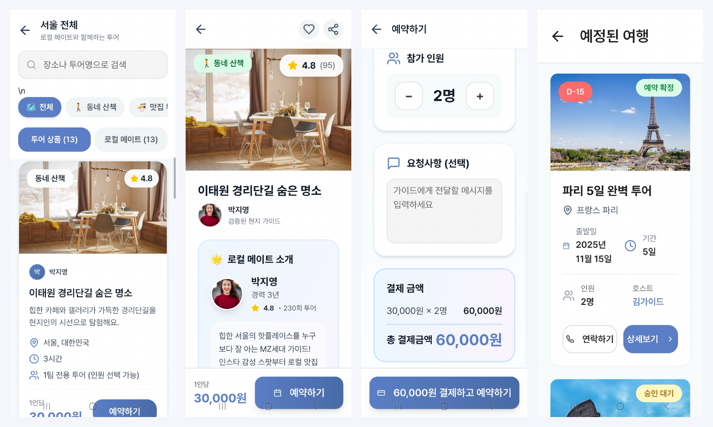
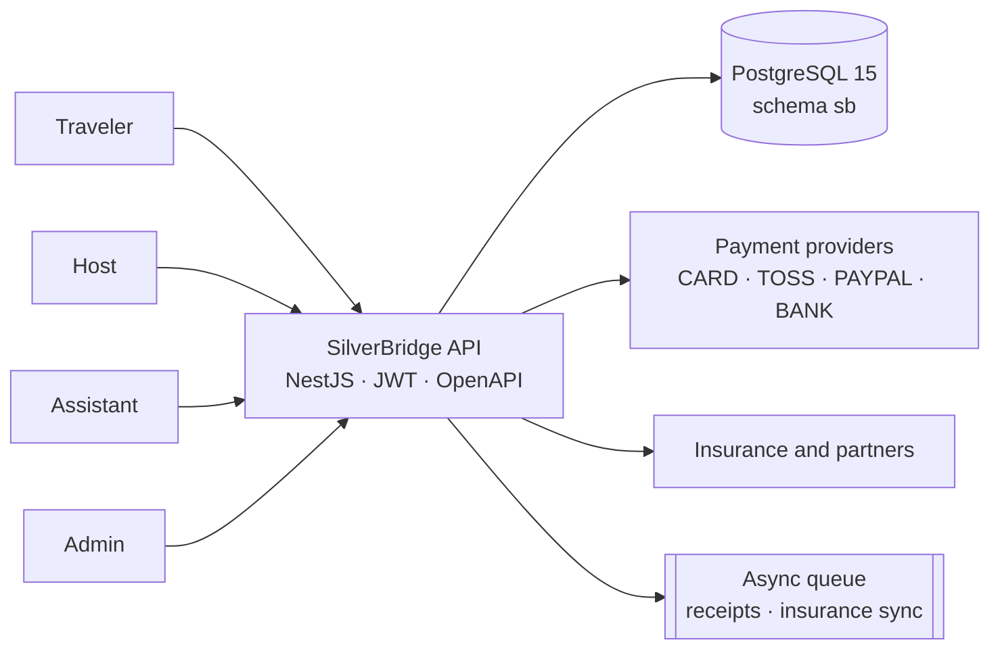
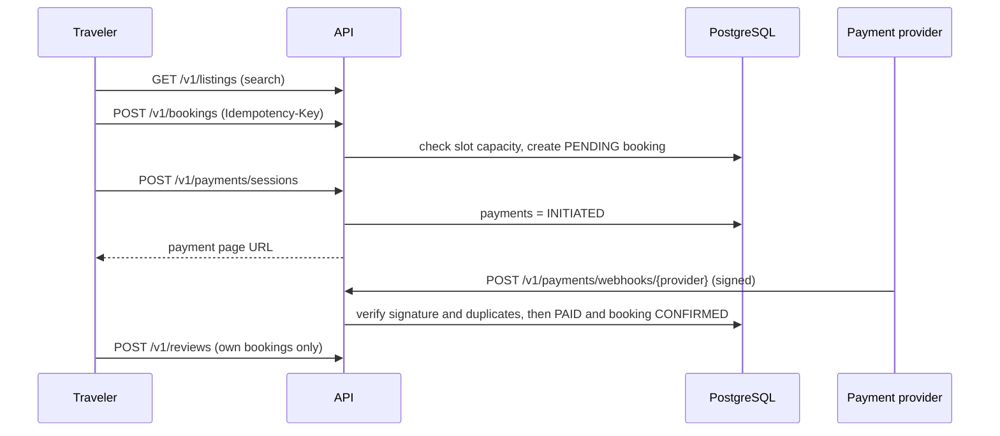

# SilverBridge — AI travel companions for seniors (backend design & API starter)

<sub>🌐 **English** · [한국어](README.ko.md)<br>[← Portfolio home](../../README.md) · **SilverBridge** · [Fee Payment Link →](../fee-payment-link-mvp/README.md) · [ADRs](docs/adr/README.md) · [Schema](design-package/02_SQL/schema.sql) · [OpenAPI](design-package/03_API/openapi.yaml)</sub>

| 31 | 14 | 5 | CI ✓ |
|:-:|:-:|:-:|:-:|
| **DB tables** | **API paths** | **ADRs** | **schema + API validated** |

> "Package tours are exhausting, and independent travel is frightening." This repo is the backend design for a travel platform that reduces that fear for seniors with **AI companion matching and real-time safety infrastructure**.

SilverBridge was built in KAIST's startup program by a four-person team of PMBA classmates (Team Jeha). This folder holds the **data model (PostgreSQL), API contract (OpenAPI), security / operations / test design, business-process models, and a NestJS API starter**.
My role on the team: **CEO and strategy lead** (as listed in the team's IR pitch deck). See "My role and contribution" below.

> **TL;DR** — Backend design for an AI travel-companion platform for seniors: 31-table PostgreSQL schema with DB-enforced rules, OpenAPI 3 contract, role / PII / SLO design, 5 ADRs. Design-first; the NestJS starter is a skeleton (gaps listed in §10). I authored the artifacts and used AI as a reviewer.

---

## Case study at a glance

| | |
|---|---|
| **Problem** | Only about 12% of the parent generation tries independent travel. The bottleneck is not demand but *fear* (getting lost, emergencies), and the payer (adult child) is not the user (parent). |
| **Approach** | AI companion matching, real-time safety infrastructure, and a senior-friendly UI. Four user roles (traveler, host, assistant, admin) designed in from day one. |
| **What I built** | Process model → 31-table schema → OpenAPI 3 contract → permission / privacy / SLO / test design → NestJS starter |
| **Key decision** | Enforce rules in **DB constraints and the API contract**, not only in application code. [Read the 5 ADRs](docs/adr/README.md) |
| **Current status** | Design artifacts complete; a Stage 3 Android MVP shipped on Supabase ([details](docs/STAGE3-MVP.md)); the booking and webhook rules are proven by [13 tests in CI](reference-impl/README.md). The NestJS starter is still skeleton-level (§10). Schema and API contract are [validated automatically by CI](../../.github/workflows/validate.yml). |
| **Validation plan** | 100 interviews (seniors and their children), then a 50-pair beta test (targets: satisfaction ≥ 75%, matching accuracy ≥ 80%). *These are plans, not achieved results.* |

## My role and contribution

I **designed and wrote** the SilverBridge artifacts in this repo myself (process model, data model, API contract, security / operations / test design, NestJS starter) and **used AI as a reviewer**. It is a case of a business and strategy owner deciding *what to build, why, and in what order*, then carrying that all the way into documents and a code skeleton a dev team can pick up.

| Area | What I did | Where to check |
|---|---|---|
| Problem definition and market logic | Framed the bottleneck of senior independent travel as fear rather than demand; derived the two-sided user structure (child pays, parent uses) | §1 below, team IR pitch deck |
| Product scope and process design | Settled matching, safety (SOS / check-in) and booking / payment as the core flows; wrote L1 and L2 processes and the swimlane | `process-models/` |
| Data modeling | Designed 31 tables; wrote booking / payment states, duplicate-booking prevention and seat limits as DB constraints | `design-package/02_SQL/`, §4 below |
| API, security and operations design | OpenAPI 3 contract, role × endpoint permission matrix, PII retention and disposal table, SLOs, test strategy | `03_API/`, `04_Security/`, `05_Operations/`, `06_Test/` |
| Hand-off ready for implementation | NestJS + Prisma starter that shows how the design turns into code | `api-starter/` |

### How I used AI
- **I write, AI checks.** Drafts and decisions are mine. I used AI to look for omissions (constraints, indexes, permission gaps), inconsistencies between documents (SQL ↔ OpenAPI ↔ permission table) and edge cases.
- This gave me a workflow that lifts design quality in specialist areas (DB, security, operations) to team level even when working alone. Final judgment and accountability stay with me.

**Honest scope.** The NestJS starter is a skeleton, not a finished implementation (unfinished items are listed in §10, "Current status and limits"). I state this on purpose so it is not read as production backend experience. What I want to show is the ability to **translate requirements into data model, API, security and operations design, and to audit the limits of my own implementation**.

---

## Team deliverables at a glance (made by me)

> These are the problem definition, solution and business-process materials the design documents started from. Excerpted from the team IR pitch deck (2025-11) and the Lucid process map. **The slide text is in Korean**; each image has an English caption below.

**Business process L1: five actors (traveler, local friend, platform, partner, admin) × seven stages, as a swimlane.** This flow becomes the tables and API endpoints of the `sb` schema.


*Stages (left to right): onboarding · trip request · matching / approval · pre-trip exchange and plan · trip and safety management · trip end and review · re-engagement and referral. Lanes: Traveler (senior), Local Friend (host), SilverBridge platform, Partner (insurance / medical / tourism), Admin. English summary: [`process-models/README.md`](process-models/README.md).*

| Problem → solution | |
|---|---|
|  |  |
| *Problem background: parents watch travel content and want to go, but packages are tiring and independent travel feels risky.* | *Personas and key numbers.* |
|  |  |
| *Solution: AI matching, senior-friendly UI and safety infrastructure reduce fear; real-time support, simple planning and verified companions prevent regret.* | *MVP core features (1).* |
|  |  |
| *MVP core features (2): local mates, content, safety.* | *Customer validation plan: 100 interviews, then a 50-pair beta test.* |

### UI draft (v1.0)

A mobile screen flow for seniors: onboarding → product detail → preference selection (purpose, style, type, activity level) → safety (GPS location, emergency call). The four preference questions map to matching-algorithm inputs (`travel_style`, activity level, and so on).


> **Source note.** This is a **draft** adapted from a commercial mobile UI kit (Figma Community), localized into Korean and arranged for the SilverBridge service flow. I include it as a reference for how the design documents connect to real screen flows, **not as evidence of my visual design skill**.

---

## What actually shipped, and the proof behind the design

The design package above is Stage 2. These four additions close the "design only" gap honestly:

| | What | Link |
|---|---|---|
| **Stage 3 MVP** | What the team actually shipped (React + Capacitor APK on Supabase), implemented vs design-only, and a gap table where the team's documents overstate the code | [STAGE3-MVP.md](docs/STAGE3-MVP.md) |
| **Running proof** | Duplicate booking, 10-way seat race, idempotency, 8× duplicate webhook, refund state machine: 13 tests on PostgreSQL, run in CI, with a mutation check | [reference-impl/](reference-impl/README.md) |
| **AWS reference architecture** | Deployment, security, scaling, cost assumptions and a Supabase → AWS migration path | [aws-reference-architecture/](aws-reference-architecture/README.md) |
| **Demo** | 2-minute captioned walkthrough built from the real `npm run demo` output and the AWS test log (no narration), plus a script for a narrated recording | [demo-walkthrough.mp4](reference-impl/demo-walkthrough.mp4) · [DEMO-SCRIPT.md](reference-impl/DEMO-SCRIPT.md) |



---

## 1. Why this exists: problem definition

The problem structure from the team IR pitch deck (2025-11). Figures are the ones cited in the deck.

| Observation | What it means |
|---|---|
| The parent generation wants to travel, but only about 12% try independent travel | They want to and cannot: the bottleneck is **fear**, not demand |
| Satisfaction with existing senior travel services is about 38% | The package-centered market lacks choice |
| 74.1% of people aged 65+ find going online uncomfortable | Ordinary travel-app UI/UX does not fit seniors |
| The payer (children in their 30s–40s) differs from the user (parents 60+) | Both users must be designed for |

**Goal:** senior satisfaction of 75% or more, and less fear (getting lost, emergencies) and less regret (trips postponed until it is too late).

## 2. Direction

- **AI companion matching.** Recommend companions (host / assistant) by age, gender, travel style, activity level and safety information.
- **Senior-friendly UI.** Large type, simple menus, voice features.
- **Safety infrastructure.** Location sharing, check-ins, an SOS button, 24-hour support.
- **Easy planning.** Saved preferences and tailored courses.

This repository is the **backend blueprint** for building those features.

## 3. System overview



## 4. Data model: 31 tables in the `sb` schema

| Area | Tables | Design intent |
|---|---|---|
| Users and identity | `users` `travelers` `hosts` `verifications` | Separate profiles per role (TRAVELER / HOST / ADMIN); track identity, phone, email and **background-check (BACKGROUND_CHECK)** verification history |
| Products and content | `locations` `listings` `amenities` `listing_amenities` `availability_slots` `media_assets` `contents` | Tours, experiences and stays (TOUR · EXPERIENCE · STAY) unified as one listing; remaining seats managed per time slot |
| Courses and matching | `courses` `course_listings` `match_candidates` `favorites` `match_feedback` | Matching results **stored per algorithm version**, with views, clicks, favorites and rejections accumulated as feedback |
| Booking and payment | `bookings` `payments` `partner_integrations` `insurance_policies` `partner_offers` | Booking and payment are separate so each state is tracked independently; extensible to insurance and partners |
| Communication | `threads` `thread_participants` `messages` `reviews` | Three-party conversation (traveler, host, assistant); 1–5 star reviews |
| Safety | `user_locations` `safety_checkins` `sos_events` | Location sharing, check-ins, SOS (OPEN → IN_PROGRESS → RESOLVED) |
| Operations and audit | `admin_actions` `disputes` `audit_logs` | Admin actions, disputes (DISPUTED) and audit trail |

## 5. Key design decisions

| # | Decision | Why | Evidence |
|---|---|---|---|
| 1 | Enforce state values with `CHECK` constraints in the DB (booking PENDING / CONFIRMED / CANCELLED / COMPLETED / DISPUTED; payment INITIATED / PAID / FAILED / REFUNDED / PARTIAL_REFUNDED) | Invalid states cannot be stored even if the application has a bug | `02_SQL/schema.sql` |
| 2 | Manage seat inventory in `availability_slots(seats_total, seats_reserved)` and apply `UNIQUE(listing_id, slot_id, traveler_id)` on `bookings` | Blocks duplicate bookings of the same slot by the same user at the DB level | `schema.sql` |
| 3 | Put `algo_version` on matching results, with `UNIQUE(traveler_id, listing_id, algo_version)` | Results stay comparable when the algorithm changes; no duplicates on recompute | `schema.sql` |
| 4 | `Idempotency-Key` on `POST /v1/bookings`; payment webhooks use signature verification plus a duplicate event key | Network retries and webhook redelivery never create duplicate bookings or payments | `04_Security/SECURITY.md` |
| 5 | Role × endpoint permission matrix plus ownership checks (users only access their own bookings, messages and reviews); assistant assignment is created by an admin and approved by the assistant | Least privilege; prevents permission abuse when a senior is served through a proxy | `SECURITY.md` |
| 6 | Encryption, retention and disposal table per sensitive field (phone numbers KMS-encrypted and kept 3 years after withdrawal; location data anonymized or deleted after 6 months; payment transaction IDs kept 5 years, etc.) | Addresses personal-data and location-data issues at design time | `SECURITY.md` |
| 7 | Messages, audit logs and location tables designated as **monthly range-partitioning candidates**; post-payment work (receipts, insurance sync) moved to a queue | Prepares write-heavy log tables for growth and keeps payment responses fast | `05_Operations/OPERATIONS.md` |
| 8 | SLOs declared: API P95 ≤ 300 ms, availability 99.9%, error rate ≤ 0.1%, RTO 1 h / RPO 15 min (daily full backup + 7-day PITR) | The team agrees on "good enough" as numbers | `OPERATIONS.md` |
| 9 | The safety function (`POST /v1/safety/sos`) is **allowed for every role** | Permissions must never block someone in an emergency | `SECURITY.md` permission matrix |

## 6. API overview (OpenAPI 3, `03_API/openapi.yaml`)

| Area | Endpoints |
|---|---|
| Auth | `POST /v1/auth/login` |
| Listings | `GET /v1/listings` · `GET /v1/listings/{listingId}` · `GET /v1/availability/{listingId}` |
| Booking | `POST /v1/bookings` |
| Payment | `POST /v1/payments/sessions` · `POST /v1/payments/webhooks/{provider}` |
| Communication | `POST /v1/messages/threads` · `GET·POST /v1/messages/{threadId}` · `POST /v1/reviews` |
| Companion and concierge | `POST /v1/assistants/assign` · `POST /v1/concierge/sessions` |
| Safety and operations | `POST /v1/safety/sos` · `GET /v1/admin/audit` |

**Representative scenario (Scenario A in the test strategy)**



## 7. Test strategy (`06_Test/TEST_STRATEGY.md`)

- **Unit:** seat validation, payment amount calculation, permission checks (service layer, mock-based)
- **Contract:** OpenAPI-schema-based frontend / backend contract tests; integration scenarios on a test DB with migrations applied
- **Performance:** error rate and lock wait under slot contention at 100–300 concurrent RPS on `/v1/bookings`; payment-session spikes
- **Security:** JWT forgery, privilege escalation, rate limiting, webhook signature tampering
- **Scenario B:** concurrent bookings on the same slot, confirming a "not enough seats" error

## 8. Folder structure

> Also see `reference-impl/` (tests on PostgreSQL), `aws-reference-architecture/`, and `docs/STAGE3-MVP.md`.

```
silverbridge-backend/
├─ design-package/          # final design package (logical / physical model, backend design)
│  ├─ 01_ERD/               # ERD notes (source is in Lucidchart)
│  ├─ 02_SQL/               # schema.sql · migrations/001_init_sb.sql · seed.sql
│  ├─ 03_API/openapi.yaml
│  ├─ 04_Security/SECURITY.md
│  ├─ 05_Operations/OPERATIONS.md
│  └─ 06_Test/TEST_STRATEGY.md
├─ api-starter/             # NestJS + Prisma scaffold (listings · bookings · payments)
└─ process-models/          # L1 / L2 business processes, swimlane, table dictionary (CSV, Korean source data)
```

## 9. How to run

```bash
# 1) Reproduce the DB (PostgreSQL 15)
psql -f design-package/02_SQL/schema.sql
psql -f design-package/02_SQL/seed.sql

# 2) API starter
cd api-starter
cp .env.example .env            # set DATABASE_URL
npm install
npm run prisma:generate
npm run start:dev
```

## 10. Current status and limits (honestly)

This repo is **design-centered**. The code is scaffold level; these are the known gaps.

- `api-starter/prisma/schema.prisma` has no models yet. Pull the `sb.*` schema with `prisma db pull` to fill it in.
- The `traveler_id` in booking creation is a placeholder (authentication not wired in), and the payment webhook handler is a stub that only acknowledges receipt. Signature verification and duplicate-event handling exist only as documentation (SECURITY.md).
- The seat check reads remaining seats inside a transaction, which does not prevent overbooking under concurrent requests. That needs a row lock (`SELECT … FOR UPDATE`) or an atomic increment query. Test Scenario B exists to verify this.

## 11. Next steps

1. Generate Prisma models; implement JWT authentication and role guards
2. Change seat booking to an atomic update and automate the concurrency test (Scenario B)
3. Webhook signature verification plus idempotent handling by inserting the event ID first (reusing the design pattern of the sister project [fee-payment-link-mvp](../fee-payment-link-mvp))
4. Implement a first version of the matching score (age, preferences, activity level, safety information) as `algo_version = v1`
