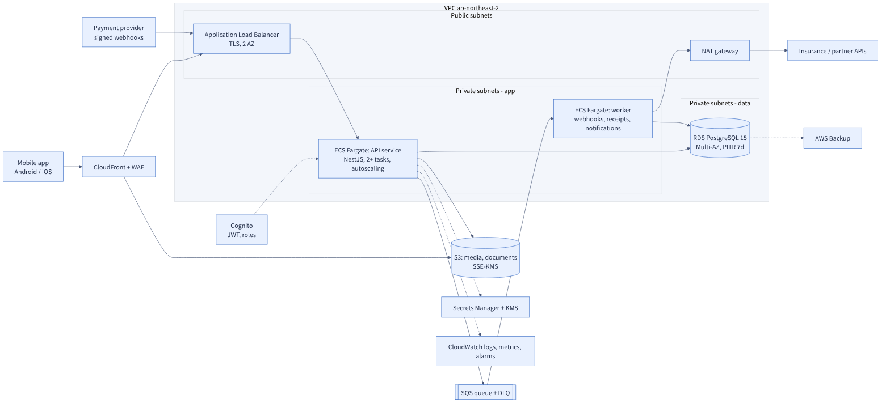

# AWS reference architecture — SilverBridge production target

[← SilverBridge case study](../README.md) · [Stage 3 MVP](../docs/STAGE3-MVP.md) · [Operations design](../design-package/05_Operations/OPERATIONS.md) · [Security design](../design-package/04_Security/SECURITY.md)

> [!IMPORTANT]
> **A design for the production target, not a deployed system.** Costs are order-of-magnitude estimates from list-price assumptions I state below; verify them in the AWS Pricing Calculator before any commitment. The Stage 3 MVP actually runs on Supabase ([why](../docs/STAGE3-MVP.md)); this page shows where the design would go next and how to get there.

Source: [`arch.mmd`](arch.mmd)

## 1. Deployment structure

| Layer | Choice | Why |
|---|---|---|
| Edge | CloudFront + WAF | TLS, rate limiting, basic bot / injection rules in front of the API and media |
| Ingress | Application Load Balancer across 2 AZs | Also receives payment-provider webhooks; the app verifies signatures |
| Compute | ECS Fargate: **API service** (2+ tasks, autoscaling) and **worker** (queue consumer) | No servers to patch; webhook side-effects (receipts, notifications, insurance sync) leave the request path, as the operations design requires |
| Data | RDS PostgreSQL 15, Multi-AZ, 7-day point-in-time recovery | Runs the 31-table `sb` schema as designed; the Stage 3 KV data does not migrate 1:1 (see §6) |
| Async | SQS + dead-letter queue | Retry without losing events; DLQ is an alarm, not a graveyard |
| Files | S3 with SSE-KMS, served via CloudFront | Review photos, documents |
| Identity | Cognito (JWT) mapped to the TRAVELER / HOST / ADMIN roles | Matches the role × endpoint matrix; replaces Supabase Auth |
| Secrets | Secrets Manager + KMS | Provider keys, webhook secrets, DB credentials; nothing in images or env files |
| Observability | CloudWatch logs, metrics, alarms | Alarms on 5xx, p95 latency, DLQ depth, RDS CPU / connections |

## 2. Security configuration

| Control | Setting |
|---|---|
| Network | App and DB in private subnets; DB reachable only from the API / worker security groups; one NAT for outbound partner calls |
| Encryption | TLS in transit; KMS at rest for RDS, S3, backups; field-level encryption for phone numbers per the [retention table](../design-package/04_Security/SECURITY.md) |
| Least privilege | One IAM task role per service; the API cannot read the payment-secret scope the worker uses |
| Webhooks | HMAC verification and event-ID-first idempotency, [proven by tests](../reference-impl/README.md) |
| Audit | Admin actions written to `audit_logs`; CloudTrail for infrastructure changes |
| Data protection | Location data retention per the schema's retention policy; automated deletion job |

## 3. Scaling points

| Pressure | First move | Next move |
|---|---|---|
| More API traffic | Raise Fargate task count (CPU-based autoscaling) | Split read-heavy listing search into its own service |
| DB connections | RDS Proxy | Read replica for search and analytics |
| Write-heavy logs (`messages`, `audit_logs`, `user_locations`) | Monthly range partitions (already a design decision) | Move cold partitions to S3 / warehouse |
| Webhook spikes | Queue absorbs; scale workers on queue depth | Separate queue per provider |
| Media | CloudFront caching | Image resizing pipeline |

## 4. Reliability targets (from the operations design)

| Target | Value | How this architecture supports it |
|---|---|---|
| API availability | 99.9% | Multi-AZ ALB, ≥ 2 tasks across AZs, Multi-AZ RDS |
| API p95 | ≤ 300 ms | Indexed queries, connection pooling, cached listings |
| RPO / RTO | 15 min / 1 h | PITR + AWS Backup; runbook-driven restore, restore drill each quarter |

## 5. Cost estimate (monthly, small production, ~1–2k MAU)

Assumptions: Seoul region, on-demand list prices as I remember them, 730 hours, light traffic, one NAT gateway, no reserved instances. **Treat each line as ±40%.**

| Component | Sizing | Est. USD / month |
|---|---|--:|
| Fargate API (2 tasks) | 0.5 vCPU, 1 GB each | 35–50 |
| Fargate worker (1 task) | 0.25 vCPU, 0.5 GB | 10–15 |
| RDS PostgreSQL Multi-AZ | 2 vCPU burstable class, 50 GB gp3 | 120–180 |
| Application Load Balancer | 1 ALB, low LCU | 20–30 |
| NAT gateway | 1 (single AZ) | 40–50 |
| CloudFront + WAF | low traffic, a few managed rules | 15–30 |
| S3, SQS, Secrets Manager, KMS | low volume | 10–20 |
| CloudWatch, backups | 30-day logs, 7-day backup | 15–30 |
| **Total** | | **≈ 270–400** |

Cost levers, in order of size: RDS single-AZ for staging (−50%), NAT replacement with VPC endpoints for S3/SQS, Fargate Spot for the worker, Savings Plans after load is known. Cost drivers to watch as MAU grows: RDS size, NAT data processing, log volume.

## 6. Migration path from the Stage 3 MVP (Supabase)

| Step | What | Exit check |
|---|---|---|
| 1 | Freeze the KV schema; export users, bookings, reviews as JSON | Row counts match the source |
| 2 | Load the `sb` schema (+ the [hardening migration](../reference-impl/sql/002_reference_hardening.sql)) into RDS | Schema CI green |
| 3 | Write one-off transforms KV → relational (bookings need `slot_id` and seat reconciliation, which the KV data never tracked) | Seat counters reconcile; duplicates reported, not silently dropped |
| 4 | Replace Supabase Auth with Cognito; migrate users with a forced password reset | Login works for a pilot cohort |
| 5 | Dual-run API behind a flag; shadow-compare responses | Diff rate under agreed threshold |
| 6 | Cut over, keep Supabase read-only for 2 weeks | Rollback tested |

Data-quality risk to expect: the MVP allowed duplicate bookings and arbitrary field updates ([gap table](../docs/STAGE3-MVP.md#4-honest-gap-table-documents-vs-code)), so migrated data needs a cleanup pass, not just a copy.

## 7. Trade-offs I would state to a customer

- **Why not stay on Supabase?** It is a good fit for the MVP. The reasons to move are the relational guarantees the design depends on, enterprise network isolation, and audit requirements, not any single feature.
- **Why ECS Fargate rather than Lambda or EKS?** Long-lived connections to Postgres and steady traffic favour containers; EKS is more operations than a small team should carry.
- **Why not microservices?** Same reasoning as the [modular-monolith decision](../../fee-payment-link-mvp/README.md#4-2-architecture-modular-monolith-with-a-payment-provider-adapter) in the payments project.
