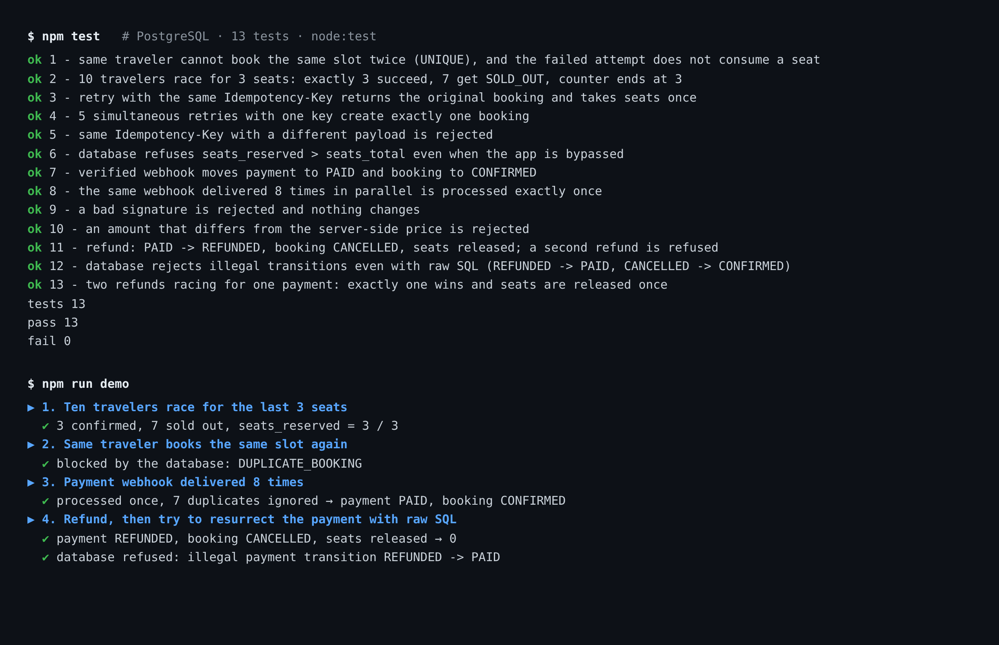

# Reference implementation — rules from the design, running against PostgreSQL

<sub>[← SilverBridge case study](../README.md) · [Stage 3 MVP](../docs/STAGE3-MVP.md)</sub>

The design package says *"duplicate bookings, overbooking and duplicate webhooks are prevented"*. This folder is the **proof**: a small implementation (≈200 lines, Node + `pg`) and **13 tests** that run against a real PostgreSQL loaded with the unchanged [`schema.sql`](../design-package/02_SQL/schema.sql). CI runs them on every push.



## One rule: from problem to test

**Problem:** a successful booking screen does not prove that retries or concurrent users cannot reserve too many seats.

**Implementation:** [createBooking](src/bookings.js) runs in a database transaction. It first records an idempotency key with a request hash. A matching retry returns the existing booking; reusing the key for a different payload is rejected. Seat reservation is one conditional update, with the capacity check in the same statement. A separate uniqueness constraint rejects a second booking for the same traveler/listing/slot; failure rolls back the transaction.

**Verification:** [booking.test.js](test/booking.test.js) sends ten concurrent requests for three seats and asserts three successes, seven sold-out responses and a final reserved count of three. It also tests simultaneous retries with one key and checks that a rejected duplicate does not consume extra seats. The mutation-check results below distinguish tests that detect missing protections from tests that only exercise a happy path.

This is an AI-assisted, focused rules implementation after the MVP review. The same rules are not claimed to be integrated into the Supabase Android MVP. Its concurrency test is a correctness example, not a production load benchmark.

## What is proven

| Rule | Where it is enforced | Test |
|---|---|---|
| Same traveler cannot book the same slot twice | `UNIQUE(listing_id, slot_id, traveler_id)` (from the design) | `booking.test.js` #1 |
| 10 travelers racing for 3 seats → exactly 3 win | One atomic conditional `UPDATE … WHERE seats_reserved + pax <= seats_total` + `CHECK` bound | #2, #6 |
| Retried `POST /bookings` never double-books | `Idempotency-Key` table; same key + different payload is rejected | #3, #4, #5 |
| A webhook delivered 8× is processed once | Event ID inserted first (`ON CONFLICT DO NOTHING`) | `payment.test.js` #8 |
| Forged or tampered webhooks change nothing | HMAC-SHA256, constant-time compare; amount checked against the server-side price | #9, #10 |
| Refund is one-way and releases seats once | `PAID → REFUNDED` under row lock; two racing refunds → one wins | #11, #13 |
| Illegal states are impossible even via raw SQL | `BEFORE UPDATE` triggers for booking and payment state machines | #12 |

## Do the tests actually test anything? (mutation check)

I removed each protection and re-ran the suite. A test that cannot fail is not evidence.

| Protection removed | Result |
|---|---|
| Dropped the `UNIQUE` on bookings | test #1 fails |
| Removed the duplicate-event early return in the webhook handler | test #8 fails |
| Removed the seat-capacity condition and the `CHECK` bound | tests #2 and #6 fail |
| Nothing removed | 13 / 13 pass |

## What this found in my own design

The 31-table schema did **not** contain everything its own API contract promises. `002_reference_hardening.sql` adds, without touching `schema.sql`: `idempotency_keys`, `provider_events`, `UNIQUE(provider, provider_txn_id)`, a seat `CHECK`, and the two transition triggers. Table count is therefore 33 here, 31 in the design. These should be folded into the next schema revision.

## Run it

```bash
export PGHOST=localhost PGUSER=postgres PGPASSWORD=postgres PGDATABASE=postgres
npm install
npm run db:setup   # drops/recreates schema sb, applies schema.sql + 002 (use a scratch database)
npm test
npm run demo       # narrated 90-second walkthrough, good for a screen recording
```

## Limits

- No HTTP layer, authentication or real payment provider; the provider is a signed mock.
- Refunds are full refunds only; `PARTIAL_REFUNDED` is allowed by the state machine but not exercised.
- Concurrency is tested at 10-way parallelism on one database, not at load.
